# Plex Discord Theater

Current release: **v1.2.2**. Images are published as
`ghcr.io/monkeygonewild/plex-discord-theater:latest` and
`ghcr.io/monkeygonewild/plex-discord-theater:1.2.2`.

A Discord Activity for synchronized watch parties from a Plex Media Server. One
person hosts, playback stays in lockstep for everyone in the voice channel, and
each viewer can independently select audio tracks, subtitles and quality.

> [!WARNING]
> **This project was built with AI.** It was developed primarily with
> AI-assisted tooling and has not had an external security review. Treat it as
> a hobby project: run it on infrastructure you control, for people you know,
> and do not expose it as a public service.

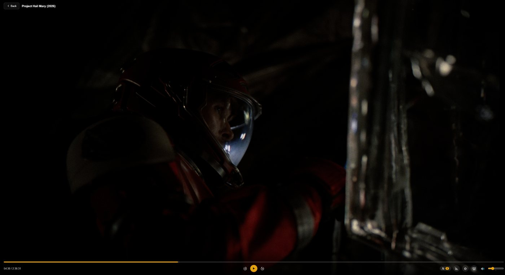

**[Read the documentation →](https://github.com/MonkeyGoneWIld/plex-discord-theater/wiki)**

## Overview

Join a Discord voice channel, launch the Activity, and invite friends. Everyone
in the channel joins the same room automatically.

The Activity provides a full Plex browser, including:

- The Plex home screen, movies, and TV libraries
- Unified search across the local library and Plex Discover
- Title pages with summaries, ratings, cast, versions, and tracks
- Synchronized playback controls (pause, seek, skip intro, next episode)
- Picture-in-picture, to keep watching while you browse
- Viewer suggestions and host/co-host role management
- Optional per-user sync of progress, watched status, and Universal Watchlist

## Features

### Synchronized playback

The host controls the room timeline. Playback stays in sync for all viewers.
Hosts can grant playback control to co-hosts or transfer the host role. Viewers
can ask the host or a co-host to pause or resume.

### Plex browser

The home screen renders the same hubs Plex generates, including Continue
Watching and recommendation rows.

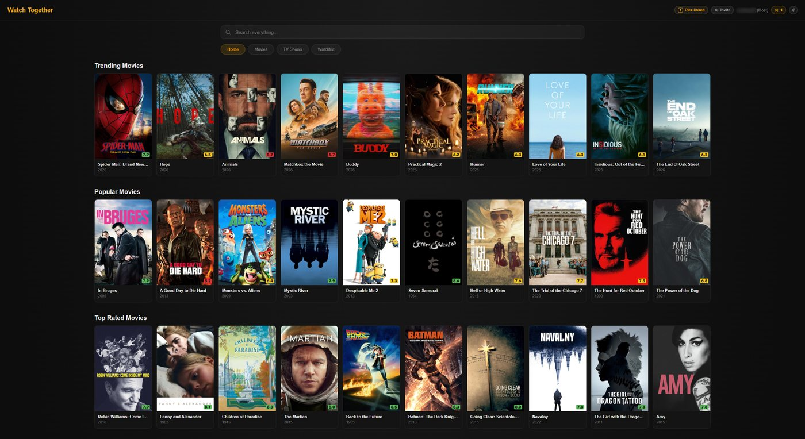

Search covers both the local library and Plex Discover. Results not present on
the server are labelled **Not in library**.

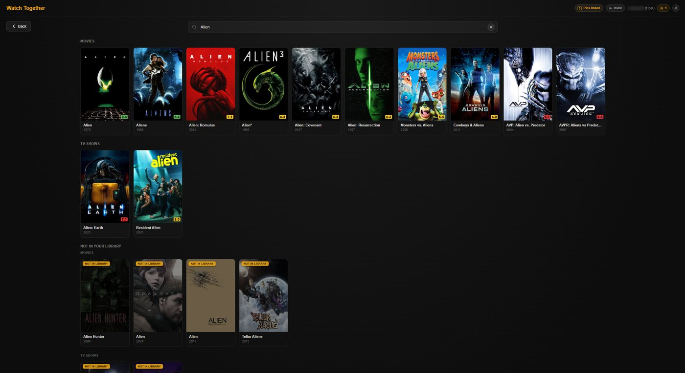

Title pages include description, ratings, cast and crew, collections, similar titles, available versions,
audio tracks, and subtitles. IMDb, TMDB, and Rotten Tomatoes critic and audience ratings come directly from Plex when available; no separate ratings API key is required.

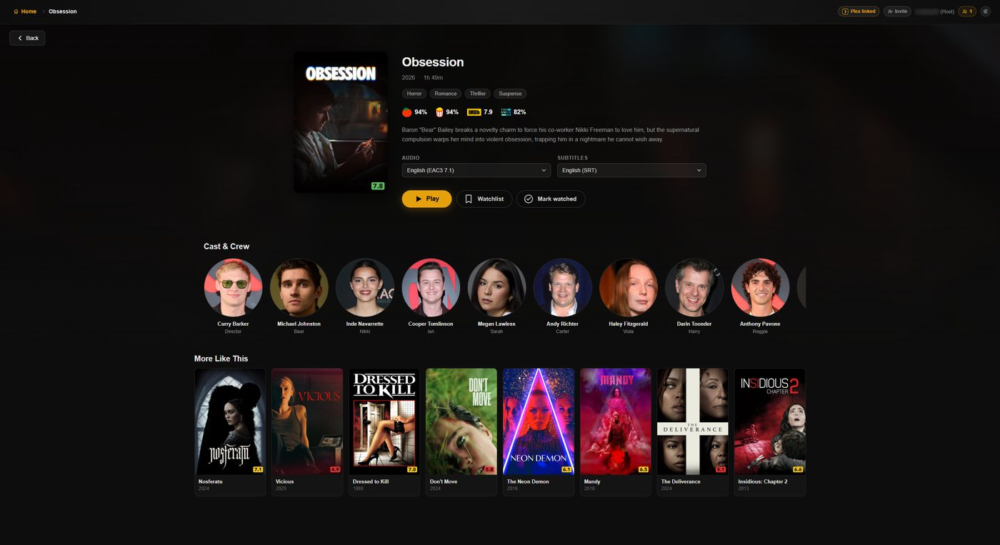

Cast and crew pages list library titles first, followed by the rest of the
person's filmography. Out-of-library titles can be requested when Seerr is
connected.

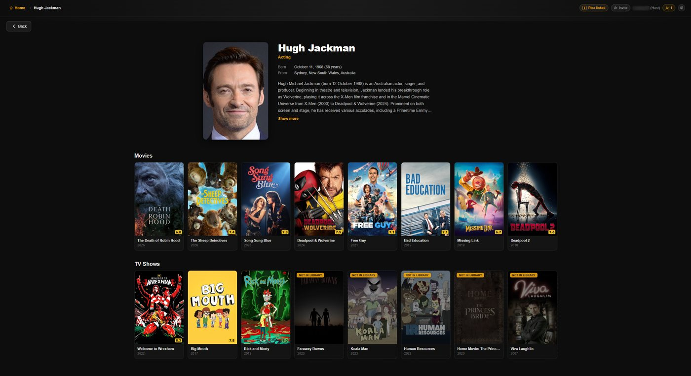

For TV shows, season pages show missing and unaired episodes with air dates, and
available episodes can be played directly from the season view.

### Per-viewer audio, subtitles and quality

Each viewer picks their own audio track, subtitles and quality without
changing anyone else's, and their choices carry into the next episode.

A viewer on a slow connection can pick a lower quality and get a stream of
their own, and a player that can't decode HEVC gets an H.264 stream of its own,
so nobody else's picture is lowered for them.

Subtitles are drawn by each player, styled the way Plex draws them. Their size,
position, colour, background and font can be changed from the subtitle button
in the player bar, which also moves subtitles that are out of sync earlier or
later:

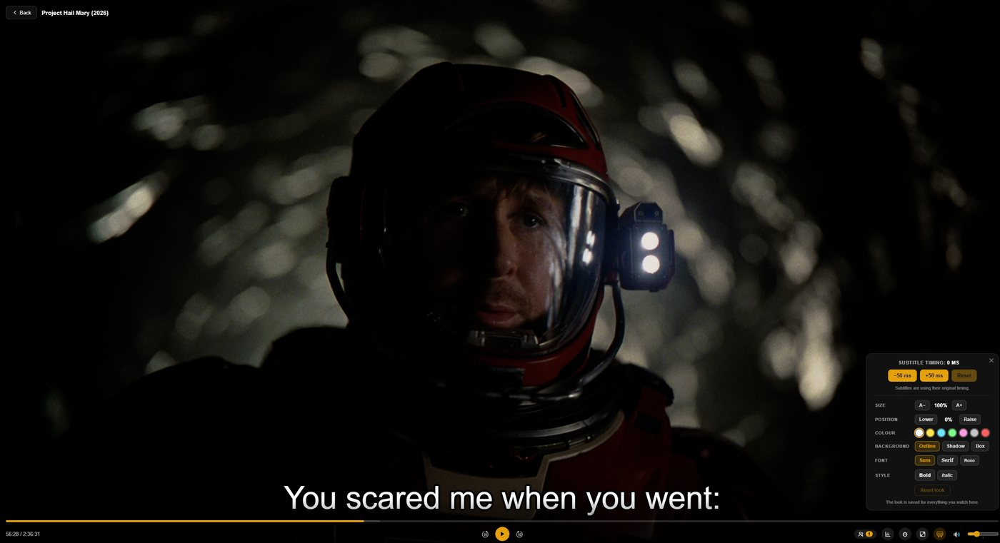

**Settings** sets what every title starts with for you: subtitle and audio
languages (subtitles can be shown only when the audio is in another language),
default quality, volume, the subtitle look, and your watch history setting.

### Playback features

- **Viewer suggestions:** any participant can queue a title for the host.
- **Up next:** a card offers the next episode near the end; nothing starts on
  its own.
- **Picture-in-picture:** press **Back** to keep watching in a small window
  while you browse; double-click or tap it to return to the full player.
- **Watch history settings:** choose whether watch parties count toward your
  history always, or only when you host.
- **Skip Intro / Skip Credits:** uses markers generated by Plex.
- **Seek previews:** hover or scrub the timeline to see Plex-generated preview
  frames.
- **Video zoom:** fill the screen, match its width or height, widescreen,
  ultrawide or a custom zoom, saved per title.
- **Play Version:** choose between multiple versions of a title when available.
- **Stats for nerds:** press `i` for codec, bitrate, buffer and connection, and
  whether the video is copied or re-encoded and why.
- **Watched controls:** mark a title watched, or apply the change to a whole
  season or show. Works with or without a linked Plex account.

Picture-in-picture keeps the film playing over the library:

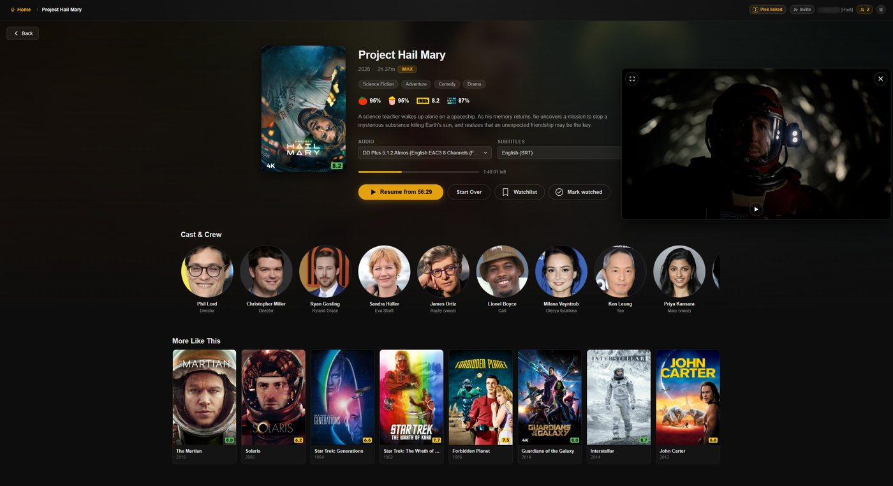

> [!NOTE]
> Skip buttons and seek previews require Plex to have generated the underlying
> data. Enable **Detect intros and credits** and **Generate video preview
> thumbnails** under **Library → Edit → Advanced** in Plex.

### Discord Rich Presence

Your Discord profile shows **Watching** with the title, its artwork and how far
through it the room is. Anyone can switch to a plain watching status for
themselves under **People**.

### Mobile support

The mobile layout includes compact library rows, stacked title pages, controls
adapted to Discord's mobile header, a centered play button, and double-tap to
skip ten seconds.

| 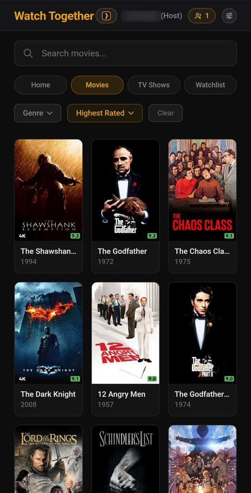 | 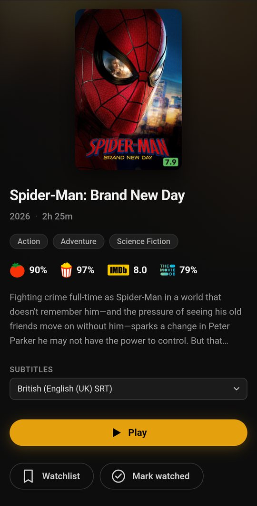 |
| :-- | :-- |
| Browse with three posters per row. | Open a title without desktop-sized clutter. |

## Personal Plex sync

Each viewer can link their own Plex account, through Plex's own sign-in page:

- Watched status and resume points sync both ways, Continue Watching included
- Watch-party progress counts on every linked viewer's account
- Their Plex Universal Watchlist appears as a tab

[More →](https://github.com/MonkeyGoneWIld/plex-discord-theater/wiki/Personal-Plex-Sync)

## Requests via Seerr

When Seerr is connected, **Request** buttons appear on titles not in the
library.

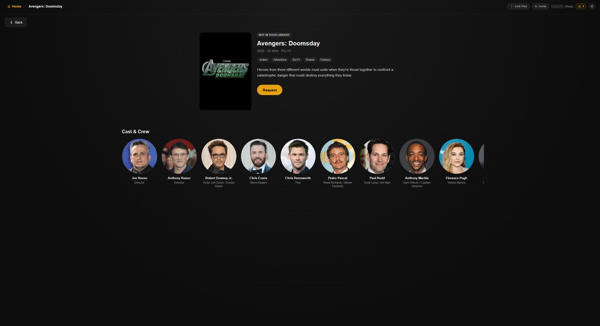

Movies can be requested in one click. For shows, users can select which missing
seasons to request and view what is already available or pending.

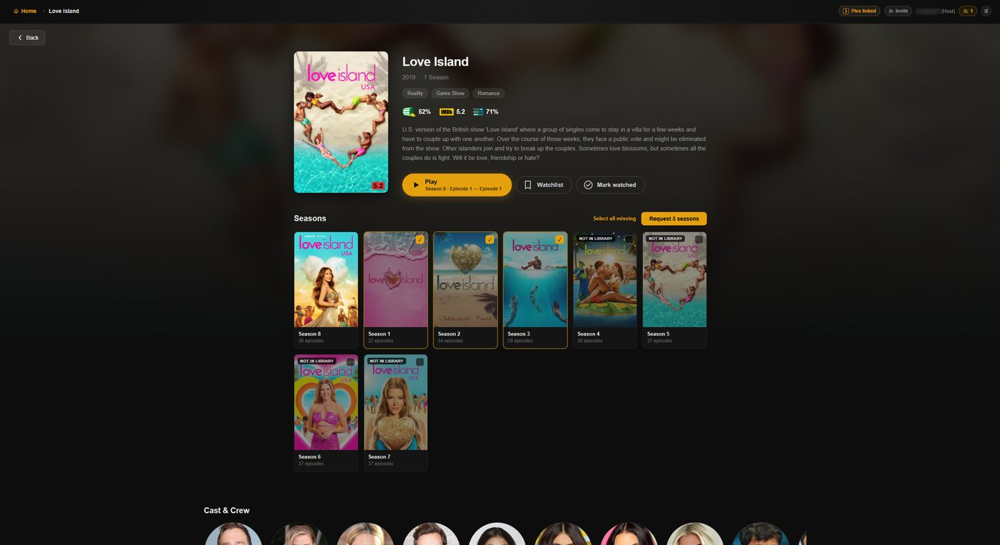

Requests authenticate to Seerr using the configured Plex account, so no Seerr
administrator API key is required.

## For server owners

- **Original picture:** H.264 and HEVC files up to 1080p and within your
  bitrate limit are copied, not re-encoded, for players that can decode them.
- **HEVC transcodes:** a sharper picture at the same bitrate for players that
  decode HEVC, with Plex Pass and hardware encoding (or the ffmpeg engine).
- **FFmpeg engine (optional):** streams made in the container on Intel Quick
  Sync, HDR kept on HEVC re-encodes; Plex covers anything it can't make.
  [More →](https://github.com/MonkeyGoneWIld/plex-discord-theater/wiki/FFmpeg-Engine)
- **Shared bandwidth:** viewers on the same stream pass segments to each other,
  peer to peer, which eases your upload.
- **VPS relay (optional):** your home connection uploads one stream and a VPS
  serves the whole room.
  [More →](https://github.com/MonkeyGoneWIld/plex-discord-theater/wiki/VPS-Relay)
- **qBittorrent upload limits (optional):**
  [plex-qbt-manager](https://github.com/MonkeyGoneWIld/plex-qbt-manager) makes
  room in qBittorrent's upload while the room plays.
  [More →](https://github.com/MonkeyGoneWIld/plex-discord-theater/wiki/qBittorrent-Manager-API)
- **Instant skips back:** the films being played are kept in memory and on
  disk, so going back plays at once.
- **Fast title pages:** a background warm-up caches details and artwork for
  your newest titles, holding off while a room plays.
- **Private:** Plex tokens never reach a browser, and the Activity can be
  limited to your own Discord servers.
- **Diagnostic logs:** every viewer's player events land in the server's log
  file, with tokens redacted, so a stream that failed can be traced afterwards.

## Installation

> **Full walkthrough:** the
> [wiki](https://github.com/MonkeyGoneWIld/plex-discord-theater/wiki/Installation)
> covers each step in detail, including
> [the Discord side](https://github.com/MonkeyGoneWIld/plex-discord-theater/wiki/Discord-Application-Setup)
> and how to keep the app private.

### Requirements

- Plex Media Server with transcoding enabled
- Docker
- Optional, for the [ffmpeg engine](https://github.com/MonkeyGoneWIld/plex-discord-theater/wiki/FFmpeg-Engine):
  the library mounted into the container, and an Intel GPU with Quick Sync for
  re-encodes
- A Discord application with Activities enabled
- A public HTTPS address forwarding to port 3000: a
  [Cloudflare Tunnel](https://github.com/MonkeyGoneWIld/plex-discord-theater/wiki/Installation#5-expose-it-over-https) is quickest, or
  any reverse proxy that passes WebSockets. Discord will not load `localhost`.

### 1. Discord application

Create an application in the
[Discord Developer Portal](https://discord.com/developers/applications), enable
**Activities → Settings**, add a URL mapping from `/` to your public HTTPS host,
and copy the **Application ID** and **Client Secret**.

> An unverified Activity only works in Discord servers with fewer than 25
> members. See
> [Discord Application Setup](https://github.com/MonkeyGoneWIld/plex-discord-theater/wiki/Discord-Application-Setup).

### 2. Plex token

Follow Plex's
[authentication token guide](https://support.plex.tv/articles/204059436-finding-an-authentication-token-x-plex-token/)
to get your `X-Plex-Token`.

### 3. Deploy

Paste this into Portainer, Dockge, or a `docker-compose.yml`. Fill in the six
values under **Required**; everything else works as it is. Uncomment the
**Recommended** ones for complete title and cast pages, and any optional
settings you want.

```yaml
services:
  plex-discord-theater:
    image: ghcr.io/monkeygonewild/plex-discord-theater:latest
    container_name: plex-discord-theater
    restart: unless-stopped
    ports:
      - "3000:3000"
    volumes:
      - app-data:/data
      # Optional: keep copied films on an SSD instead (and set
      # STREAM_CACHE_DIR below to "/cache/stream").
      # - /path/to/ssd/theater-stream-cache:/cache/stream
      # Optional, for the ffmpeg engine: your library, read-only, at the
      # path Plex has it.
      # - /mnt/media:/data/media:ro
    # Optional, for the ffmpeg engine: Intel's GPU, for Quick Sync.
    # devices:
    #   - /dev/dri:/dev/dri
    environment:
      # ── Required ─────────────────────────────────────────────────────────
      # From the Discord Developer Portal: Application ID and Client Secret.
      DISCORD_CLIENT_ID: ""
      DISCORD_CLIENT_SECRET: ""
      # Your Plex server as this container reaches it (not localhost, which
      # is the container itself), and its X-Plex-Token.
      PLEX_URL: "http://192.168.1.50:32400"
      PLEX_TOKEN: ""
      # Your public HTTPS address: https:// and the host you mapped in
      # Discord, with no trailing slash.
      REDIRECT_URI: "https://watch.example.com"
      ALLOWED_ORIGINS: "https://watch.example.com"

      # ── Defaults: change them only if you want to ────────────────────────
      # Re-encode bitrate in kbps, average and peak (keep the peak at least
      # the average). Each viewer downloads about this much.
      VIDEO_BITRATE_KBPS: "12000"
      VIDEO_PEAK_BITRATE_KBPS: "20000"
      # Copy the original video when a player can decode it. "0" re-encodes
      # everything.
      DIRECT_STREAM: "1"
      # The highest average bitrate (kbps) a file may have and still be
      # copied; bigger files are re-encoded. Unset, it is VIDEO_BITRATE_KBPS.
      # Every viewer pulls a copy at the file's own bitrate, so keep it
      # under your upload divided by how many usually watch.
      # DIRECT_STREAM_MAX_KBPS: "20000"
      # HEVC re-encodes for players that can decode HEVC. Needs Plex Pass
      # and hardware HEVC encoding in Plex; otherwise Plex sends H.264.
      HEVC_TRANSCODE: "1"
      # Memory for the films being played, MB, every stream together: copies,
      # then re-encodes. A copy past its memory goes to STREAM_CACHE_DIR on
      # disk until its stream ends. That folder is emptied at every start,
      # so give it one of its own. Up to 8 GB of memory together: lower
      # both on a small server.
      DIRECT_STREAM_MEMORY_MB: "6144"
      TRANSCODE_CACHE_MB: "2048"
      STREAM_CACHE_DIR: "/data/stream-cache"
      # Who makes the streams: "plex", or "ffmpeg" (see the ffmpeg engine
      # settings below).
      PLAYBACK_ENGINE: "plex"

      # ── Recommended: complete title, cast and Discover pages ─────────────
      # Your plex.tv ACCOUNT token, not the server token above: detail pages
      # for titles you don't own, and Seerr sign-in. How to find it: the
      # wiki's Plex Setup page.
      # PLEX_ACCOUNT_TOKEN: "your-plex-account-token"
      # Collections, "More Like This" and cast pages.
      # Free key: https://www.themoviedb.org/settings/api
      # TMDB_API_KEY: "your-tmdb-v3-api-key"
      # Missing-episode lists numbered the way Sonarr numbers them.
      # Free key: https://thetvdb.com/api-information (a PIN only for a
      # subscriber key).
      # TVDB_API_KEY: "your-tvdb-api-key"
      # TVDB_PIN: "your-tvdb-pin"

      # ── Optional: uncomment what you want ────────────────────────────────
      # The Request button, through Overseerr or Jellyseerr. Needs
      # PLEX_ACCOUNT_TOKEN too.
      # SEERR_URL: "https://requests.example.com"
      # Only these Discord servers may use it: server IDs, comma-separated.
      # ALLOWED_GUILD_IDS: "123456789012345678,234567890123456789"
      # A stable key for linked Plex accounts; keep it across deployments.
      # Without it, DISCORD_CLIENT_SECRET is used. Set it before anyone links
      # a Plex account: adding or changing it later means everyone relinks.
      # Make one with `openssl rand -hex 32`.
      # PLEX_LINK_SECRET: "64-hex-characters-from-openssl"
      # Route video through a VPS, so your upload carries one stream for
      # the whole room. See the VPS Relay page in the wiki.
      # VPS_RELAY_URL: "https://relay.example.com"
      # VPS_RELAY_KEY: "a-long-random-secret"
      # plex-qbt-manager's THEATER_API_KEY, for its upload limits.
      # QBT_MANAGER_API_KEY: "a-long-random-secret"
      # Password for the maintenance command that stops every stream the
      # bot has on Plex. Unset, it works only from inside the container.
      # ADMIN_SECRET: "a-long-random-secret"

      # ── Optional: the ffmpeg engine ──────────────────────────────────────
      # Set PLAYBACK_ENGINE above to "ffmpeg" and uncomment the library
      # mount and devices at the top. The values shown are the defaults,
      # except MEDIA_PATH_MAP; see the FFmpeg Engine page in the wiki.
      # Only if Plex sees the library at other paths than this container:
      # Plex's path=>the path here, comma-separated.
      # MEDIA_PATH_MAP: "/media=>/data/media"
      # FFMPEG_HWACCEL: "auto"                       # qsv, vaapi, nvenc, or none for the CPU
      # FFMPEG_HWACCEL_DEVICE: "/dev/dri/renderD128"
      # Re-encodes at once. Unset, 6 on the GPU and 2 on the CPU.
      # FFMPEG_MAX_ENCODES: "6"
      # Unset, each stream's whole film is made ahead (room for it in
      # STREAM_CACHE_DIR); seconds hold each run that far ahead instead.
      # FFMPEG_LOOKAHEAD: ""
      # FFMPEG_AUDIO_CHANNELS: "2"                   # 6 for 5.1 AAC
      # FFMPEG_PREVIEWS: "on"                        # previews for files Plex has none for
      # FFMPEG_HDR_REENCODE: "keep"                  # or "tonemap"
      # FFMPEG_TONEMAP: "reinhard"
      # FFMPEG_REPORT_TO_PLEX: "1"

      # ── Leave this alone: it matches the volume above ────────────────────
      THUMB_CACHE_DIR: "/data"

volumes:
  app-data:
```

Deploy the stack, or run `docker compose up -d` next to the file. Then check it
came up, and which integrations are live:

```bash
docker logs plex-discord-theater 2>&1 | grep Config
```

> Prefer to build from source? Clone the repo and run `docker compose up -d
> --build` — the bundled `docker-compose.yml` reads from a `.env` file instead.
> See [.env.example](.env.example) and the
> [Configuration Reference](https://github.com/MonkeyGoneWIld/plex-discord-theater/wiki/Configuration-Reference).

### 4. Launch in Discord

Join a voice channel, click the **Activities** rocket, and pick the application.
**Invite to Activity** brings others into the same room.

Until the app is verified, friends need to be added under **App Testers** in the
Developer Portal and accept the invite
([how](https://github.com/MonkeyGoneWIld/plex-discord-theater/wiki/Discord-Application-Setup#adding-app-testers)).

## Documentation

| | |
|---|---|
| [Installation](https://github.com/MonkeyGoneWIld/plex-discord-theater/wiki/Installation) | Full setup walkthrough |
| [Discord Application Setup](https://github.com/MonkeyGoneWIld/plex-discord-theater/wiki/Discord-Application-Setup) | Creating the app, keeping it private, the 25-member limit, verification |
| [Plex Setup](https://github.com/MonkeyGoneWIld/plex-discord-theater/wiki/Plex-Setup) | Tokens, markers, preview thumbnails |
| [Configuration Reference](https://github.com/MonkeyGoneWIld/plex-discord-theater/wiki/Configuration-Reference) | Every environment variable |
| [FFmpeg Engine](https://github.com/MonkeyGoneWIld/plex-discord-theater/wiki/FFmpeg-Engine) | Making streams in the container, Quick Sync, HDR |
| [Using the Activity](https://github.com/MonkeyGoneWIld/plex-discord-theater/wiki/Using-the-Activity) | End-user guide |
| [Optional Integrations](https://github.com/MonkeyGoneWIld/plex-discord-theater/wiki/Optional-Integrations) | TMDB, TVDB, Seerr |
| [VPS Relay](https://github.com/MonkeyGoneWIld/plex-discord-theater/wiki/VPS-Relay) | Serving large rooms from one stream |
| [Updating and Backups](https://github.com/MonkeyGoneWIld/plex-discord-theater/wiki/Updating-and-Backups) | Upgrades, data, restores |
| [Local Development](https://github.com/MonkeyGoneWIld/plex-discord-theater/wiki/Local-Development) | Running from source, tech stack |
| [Troubleshooting](https://github.com/MonkeyGoneWIld/plex-discord-theater/wiki/Troubleshooting) | When something breaks |
| [FAQ](https://github.com/MonkeyGoneWIld/plex-discord-theater/wiki/FAQ) | Common questions |

## Data and privacy

Plex tokens stay on the server: it proxies every Plex call and video segment.
Linked Plex accounts sign in on Plex's own page, and their tokens are encrypted
at rest. Sessions, watch history, linked accounts and cached artwork live in
SQLite on the data volume and survive updates; the films being played are kept
only until their stream ends. Cache sizes and the background warm-up are in the
[Configuration Reference](https://github.com/MonkeyGoneWIld/plex-discord-theater/wiki/Configuration-Reference#caching-and-performance).

## License

[GPL-3.0](LICENSE)
