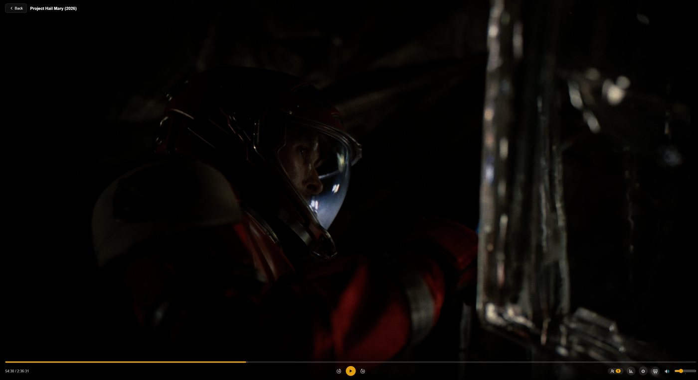
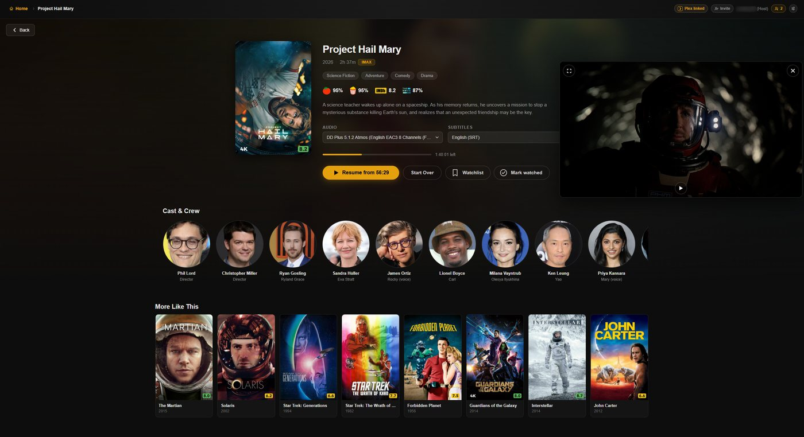
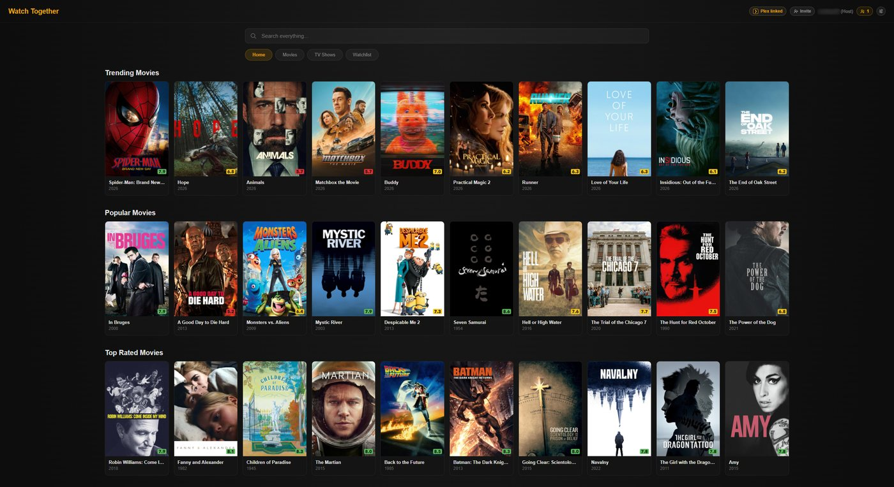
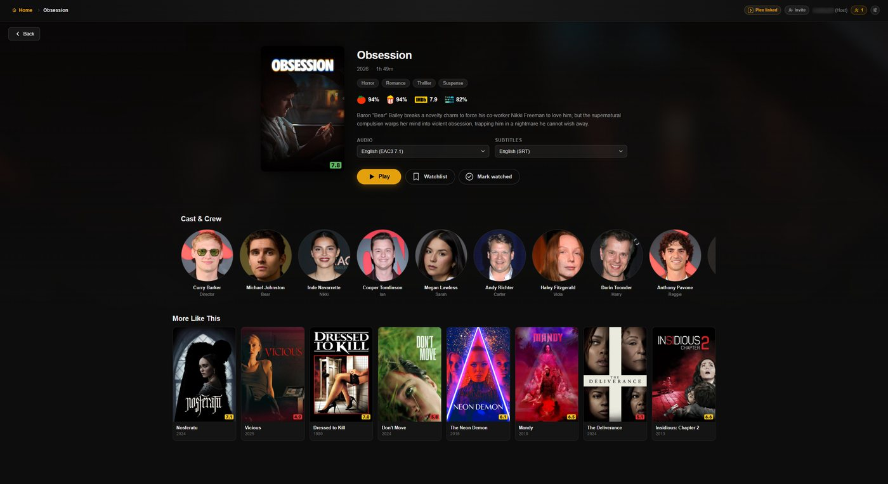
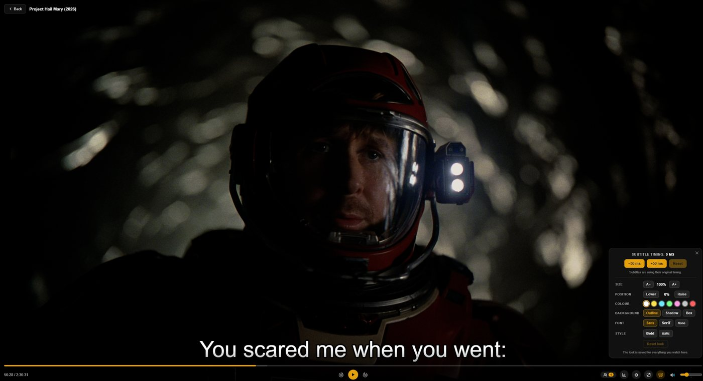
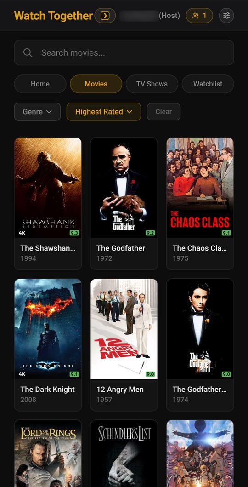
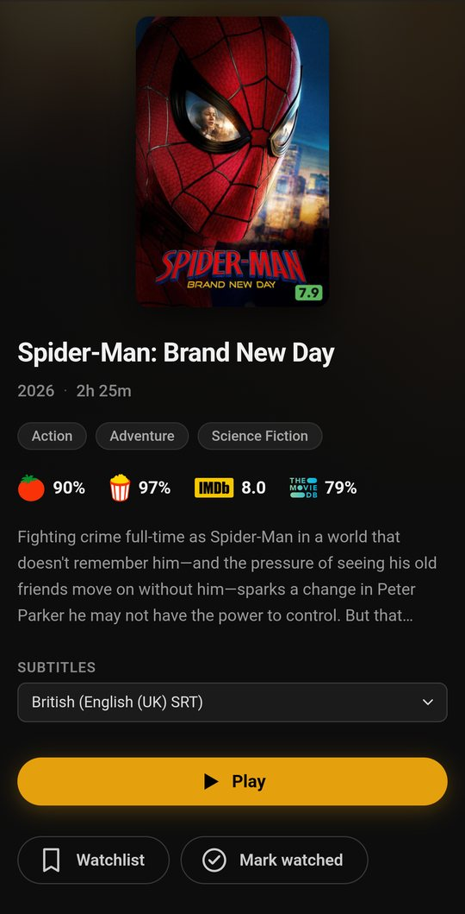
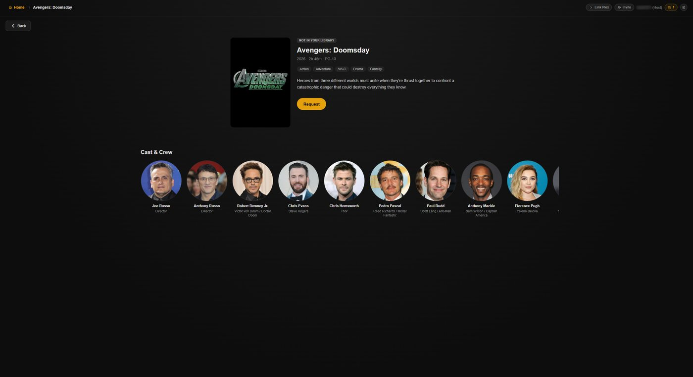
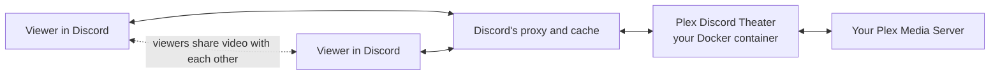

# Plex Discord Theater

**Watch your Plex library together, inside Discord.**

Plex Discord Theater is a Discord Activity for synchronized watch parties from
your own Plex Media Server. One person hosts, playback stays in step for
everyone in the room, and each viewer picks their own audio, subtitles and
quality.



**[Documentation](https://github.com/MonkeyGoneWIld/plex-discord-theater/wiki)** ·
**[Quick start](#quick-start)** ·
**[Features](#features)** ·
**[For server owners](#for-server-owners)**

Current release: **v2.2.0** · `ghcr.io/monkeygonewild/plex-discord-theater:latest`

> [!WARNING]
> **This project was built with AI.** It was developed primarily with
> AI-assisted tooling and has not had an external security review. Treat it as
> a hobby project: run it on infrastructure you control, for people you know,
> and do not expose it as a public service.

## Why you'll like it

| | |
|---|---|
| **One room, one timeline** | The host plays, pauses and seeks, and everyone stays in step. No screen sharing, no countdowns. |
| **Your whole library** | Browse the same home screen, libraries, search and title pages you know from Plex. |
| **Everyone's own choices** | Each viewer picks their audio track, subtitles and quality without changing anyone else's. |
| **The original picture** | Files your viewers can play are sent as they are, 4K and HDR included. Nothing is re-encoded unless it has to be. |
| **Desktop and mobile** | Works in Discord on Windows, macOS, Linux, the web, iOS and Android. |
| **Yours to run** | One Docker container beside your Plex server. Your Plex token never leaves it. |

## Features

### Watch together

Launch the Activity from any voice or text channel and everyone who joins lands
in the same room. The host controls the timeline, can name co-hosts, and can
hand the room to someone else. Viewers can suggest what to watch next, ask for
a pause, or ask to take over when the host has stepped away.

- **Up next** offers the next episode near the end. Nothing starts by itself.
- **Skip Intro** and **Skip Credits**, from Plex's own markers.
- **Picture-in-picture** keeps the film playing while you browse.
- **Discord Rich Presence** shows what the room is watching on your profile.



### A full Plex browser

The home screen shows the hubs Plex generates, including Continue Watching.
Search covers your library and Plex Discover, and title pages carry ratings,
cast, collections, versions and tracks.





### Audio, subtitles and quality for each viewer

Every viewer chooses their own audio track, subtitles and quality, and those
choices carry into the next episode. A viewer on a slow connection can lower
their quality and gets a stream of their own, so nobody else's picture drops.

Subtitles are drawn by each player. Their size, position, colour and timing
can be adjusted from the player.



### Built for phones too

|  |  |
| :-- | :-- |
| Compact library rows. | Title pages sized for a phone. |

### Personal Plex sync

Each viewer can link their own Plex account through Plex's sign-in page. Watch
progress and watched status then sync to their account, and their Universal
Watchlist appears as a tab.
[More →](https://github.com/MonkeyGoneWIld/plex-discord-theater/wiki/Personal-Plex-Sync)

### Requests through Seerr

Connect Overseerr or Jellyseerr and a **Request** button appears on titles that
are not in your library. Movies take one click; for shows, viewers choose the
seasons.
[More →](https://github.com/MonkeyGoneWIld/plex-discord-theater/wiki/Requesting-Titles)



## How it works



- **The Activity** is a web app that Discord loads for everyone in the channel.
  It talks only to your Theater container, through Discord's proxy.
- **Theater** keeps the room in sync, asks Plex for the library, and serves the
  video. Your Plex token stays on the server.
- **Video** is sent as it is in the file whenever the viewer's device can play
  it. Otherwise it is transcoded, by Plex or by Theater's own FFmpeg engine,
  only for the viewers who need it.
- **Delivery** is shared. Discord's proxy caches each piece of video, and
  viewers on the same stream pass pieces to each other, so a full room costs
  your upload far less than one stream per viewer.

## For server owners

- **Direct play first.** H.264 and HEVC files within your bitrate limit
  are sent unchanged, 4K and HDR included.
- **A stream for each device.** A viewer whose device can't play the room's
  stream, or who lowers their quality, gets a stream of their own. Everyone
  else keeps the original.
- **Optional FFmpeg engine.** Theater can make the streams itself on Intel
  Quick Sync, VAAPI or NVIDIA NVENC. It keeps HDR, draws Blu-ray and DVD
  subtitles in the player without burning them in, and makes seek previews
  for files Plex has none for.
  [More →](https://github.com/MonkeyGoneWIld/plex-discord-theater/wiki/FFmpeg-Engine)
- **Dashboard.** An optional page on its own port, for you only. It shows what
  is playing right now, who is watching, why each stream is direct or
  transcoded, and where the data is coming from, with a full history,
  statistics, users, requests, caches and logs.
  [More →](https://github.com/MonkeyGoneWIld/plex-discord-theater/wiki/Dashboard)
- **qBittorrent upload limits.** The optional
  [plex-qbt-manager](https://github.com/MonkeyGoneWIld/plex-qbt-manager) makes
  room in qBittorrent's upload while people watch.
- **Private by design.** Plex tokens never reach a browser, and the Activity
  can be limited to your own Discord servers.

## Quick start

You need:

- A Plex Media Server
- Docker
- A Discord application with Activities enabled
- A public HTTPS address that forwards to the container, such as a Cloudflare
  Tunnel

The [Installation guide](https://github.com/MonkeyGoneWIld/plex-discord-theater/wiki/Installation)
walks through each step in detail.

### 1. Create the Discord application

In the [Discord Developer Portal](https://discord.com/developers/applications),
create an application, enable **Activities**, map `/` to your public HTTPS
host, and copy the **Application ID** and **Client Secret**.
[Step by step →](https://github.com/MonkeyGoneWIld/plex-discord-theater/wiki/Discord-Application-Setup)

### 2. Get your Plex token

Follow Plex's
[authentication token guide](https://support.plex.tv/articles/204059436-finding-an-authentication-token-x-plex-token/).

### 3. Deploy with Docker Compose

Fill in the six values under **Required**. Everything else works as it is. `PLEX_URL` as written reaches a Plex server on the same machine; if yours runs elsewhere, use its local network address.

```yaml
services:
  plex-discord-theater:
    image: ghcr.io/monkeygonewild/plex-discord-theater:latest
    container_name: plex-discord-theater
    restart: unless-stopped
    ports:
      - "3000:3000"
      # - "3050:3050" # The dashboard (set ADMIN_PASSWORD below). Keep it on your local network.
    extra_hosts:
      - "host.docker.internal:host-gateway" # Lets PLEX_URL below reach Plex on this machine.
    volumes:
      - app-data:/data
      # - /path/to/ssd/theater-stream-cache:/cache/stream # Optional: keep the video being played on an SSD (set STREAM_CACHE_DIR to "/cache/stream").
      # - /mnt/media:/data/media:ro # FFmpeg engine: your library, read-only, at the path Plex has it.
    # devices: # FFmpeg engine: the GPU, for Intel Quick Sync or VAAPI. For NVIDIA, see the wiki.
    #   - /dev/dri:/dev/dri
    environment:
      # ── Required ─────────────────────────────────────────────────────────
      DISCORD_CLIENT_ID: "" # From the Discord Developer Portal: Application ID.
      DISCORD_CLIENT_SECRET: "" # From the Discord Developer Portal: Client Secret.
      PLEX_URL: "http://host.docker.internal:32400" # Plex on this machine. If Plex runs elsewhere, use its local network address.
      PLEX_TOKEN: "" # Your Plex server's X-Plex-Token.
      REDIRECT_URI: "https://watch.example.com" # Your public HTTPS address, with no trailing slash.
      ALLOWED_ORIGINS: "https://watch.example.com" # The same address.

      # ── Streaming: the defaults, change them only if you want to ─────────
      DIRECT_STREAM: "1" # Send the original video unchanged when a device can play it. "0" transcodes everything.
      DIRECT_STREAM_MAX_KBPS: "100000" # Highest average bitrate (kbps) a file may have and still be sent unchanged.
      VIDEO_BITRATE_KBPS: "20000" # Average bitrate of a transcode (kbps).
      VIDEO_PEAK_BITRATE_KBPS: "200000" # Peak bitrate of a transcode (kbps).
      HEVC_TRANSCODE: "1" # HEVC transcodes for devices that play HEVC. "0" keeps them H.264.
      DIRECT_STREAM_MEMORY_MB: "6144" # Memory for video sent unchanged, all streams together.
      TRANSCODE_CACHE_MB: "2048" # Memory for transcoded video, all streams together.
      STREAM_CACHE_DIR: "/data/stream-cache" # Where the video being played is kept on disk. Emptied at every start.
      PLAYBACK_ENGINE: "plex" # Who makes the streams: "plex", or "ffmpeg" (see the FFmpeg engine below).

      # ── Recommended: complete title, cast and Discover pages ─────────────
      # PLEX_ACCOUNT_TOKEN: "" # Your plex.tv account token (not the server token): pages for titles you don't own, and Seerr sign-in.
      # TMDB_API_KEY: "" # Collections, More Like This and cast pages. Free at themoviedb.org/settings/api.
      # TVDB_API_KEY: "" # Missing-episode lists numbered as Sonarr numbers them. Free at thetvdb.com/api-information.
      # TVDB_PIN: "" # Only for a TVDB subscriber key.

      # ── Optional ─────────────────────────────────────────────────────────
      # SEERR_URL: "https://requests.example.com" # The Request button, through Overseerr or Jellyseerr. Needs PLEX_ACCOUNT_TOKEN.
      # ALLOWED_GUILD_IDS: "" # Only these Discord servers may use it: server IDs, comma-separated.
      # HOST_REQUESTS: "off" # Stops viewers asking an away host for the host role.
      # PLEX_LINK_SECRET: "" # A stable key for linked Plex accounts. Make one with: openssl rand -hex 32
      # QBT_MANAGER_API_KEY: "" # plex-qbt-manager's THEATER_API_KEY, for its upload limits.
      # ADMIN_PASSWORD: "" # Turns on the dashboard on port 3050. Use 12 characters or more.
      # ADMIN_SECRET: "" # Password for the maintenance command that stops every stream on Plex.

      # ── Optional: the FFmpeg engine ──────────────────────────────────────
      # Set PLAYBACK_ENGINE above to "ffmpeg", and uncomment the library mount and devices at the top.
      # MEDIA_PATH_MAP: "/media=>/data/media" # Only if Plex sees the library at other paths: Plex's path=>the path here.
      # FFMPEG_HWACCEL: "auto" # What transcodes run on: auto, qsv, vaapi, nvenc, or none for the CPU.
      # FFMPEG_HWACCEL_DEVICE: "/dev/dri/renderD128" # The GPU's render node.
      # FFMPEG_MAX_ENCODES: "6" # Transcodes at once. Default: 6 on a GPU, 2 on the CPU.
      # FFMPEG_PRESET: "" # Speed against quality: ultrafast to veryslow. Default: each encoder's own.
      # FFMPEG_LOOKAHEAD: "" # Seconds each stream is made ahead. Default: the whole film.
      # FFMPEG_AUDIO_CHANNELS: "6" # "2" converts surround a device can't play to stereo.
      # FFMPEG_PGS: "on" # Blu-ray and DVD subtitles drawn by the player. "off" burns them in.
      # FFMPEG_PREVIEWS: "on" # Seek-bar previews for files Plex has none for.
      # FFMPEG_HDR_REENCODE: "keep" # "tonemap" maps HDR to SDR in every transcode.
      # FFMPEG_TONEMAP: "mobius" # The curve used when HDR is mapped to SDR.
      # FFMPEG_HDR_ON_SDR: "browser" # HDR on an SDR screen: "browser" or "server".
      # FFMPEG_HDR_ON_SDR_NITS: "200" # The peak HDR is labelled with for an SDR screen.
      # FFMPEG_REPORT_TO_PLEX: "1" # Shows the engine's streams in Plex's dashboard and Tautulli.

      THUMB_CACHE_DIR: "/data" # Leave as it is: it matches the volume above.

volumes:
  app-data:
```

```bash
docker compose up -d
```

Every setting is explained in the
[Configuration Reference](https://github.com/MonkeyGoneWIld/plex-discord-theater/wiki/Configuration-Reference).

### 4. Launch it in Discord

In a voice or text channel, open the **App Launcher** and pick your
application. **Invite to Activity** brings others into the same room.
[First Launch](https://github.com/MonkeyGoneWIld/plex-discord-theater/wiki/First-Launch)
covers your first watch party.

> An unverified Discord application works in servers with fewer than 25
> members, and each viewer must be added as an App Tester. See
> [Discord Application Setup](https://github.com/MonkeyGoneWIld/plex-discord-theater/wiki/Discord-Application-Setup).

## Documentation

| | |
|---|---|
| **Set up** | [Requirements](https://github.com/MonkeyGoneWIld/plex-discord-theater/wiki/Requirements) · [Installation](https://github.com/MonkeyGoneWIld/plex-discord-theater/wiki/Installation) · [Discord Application Setup](https://github.com/MonkeyGoneWIld/plex-discord-theater/wiki/Discord-Application-Setup) · [Plex Setup](https://github.com/MonkeyGoneWIld/plex-discord-theater/wiki/Plex-Setup) · [HTTPS and Reverse Proxy](https://github.com/MonkeyGoneWIld/plex-discord-theater/wiki/HTTPS-and-Reverse-Proxy) · [First Launch](https://github.com/MonkeyGoneWIld/plex-discord-theater/wiki/First-Launch) |
| **Use** | [Using the Activity](https://github.com/MonkeyGoneWIld/plex-discord-theater/wiki/Using-the-Activity) · [Roles and Permissions](https://github.com/MonkeyGoneWIld/plex-discord-theater/wiki/Roles-and-Permissions) · [Personal Plex Sync](https://github.com/MonkeyGoneWIld/plex-discord-theater/wiki/Personal-Plex-Sync) · [Requesting Titles](https://github.com/MonkeyGoneWIld/plex-discord-theater/wiki/Requesting-Titles) |
| **Run** | [Streaming and Quality](https://github.com/MonkeyGoneWIld/plex-discord-theater/wiki/Streaming-and-Quality) · [FFmpeg Engine](https://github.com/MonkeyGoneWIld/plex-discord-theater/wiki/FFmpeg-Engine) · [Dashboard](https://github.com/MonkeyGoneWIld/plex-discord-theater/wiki/Dashboard) · [Configuration Reference](https://github.com/MonkeyGoneWIld/plex-discord-theater/wiki/Configuration-Reference) · [Optional Integrations](https://github.com/MonkeyGoneWIld/plex-discord-theater/wiki/Optional-Integrations) · [Updating and Backups](https://github.com/MonkeyGoneWIld/plex-discord-theater/wiki/Updating-and-Backups) |
| **Help** | [Troubleshooting](https://github.com/MonkeyGoneWIld/plex-discord-theater/wiki/Troubleshooting) · [FAQ](https://github.com/MonkeyGoneWIld/plex-discord-theater/wiki/FAQ) · [Local Development](https://github.com/MonkeyGoneWIld/plex-discord-theater/wiki/Local-Development) |

## Data and privacy

Your Plex token stays on the server, which proxies every Plex request and all
video. Viewers who link a Plex account sign in on Plex's own page, and their
tokens are encrypted at rest. Sessions, watch history and cached artwork are
kept in SQLite on the data volume. See
[Updating and Backups](https://github.com/MonkeyGoneWIld/plex-discord-theater/wiki/Updating-and-Backups)
for what is stored and what to back up.

## License

[GPL-3.0](LICENSE)
