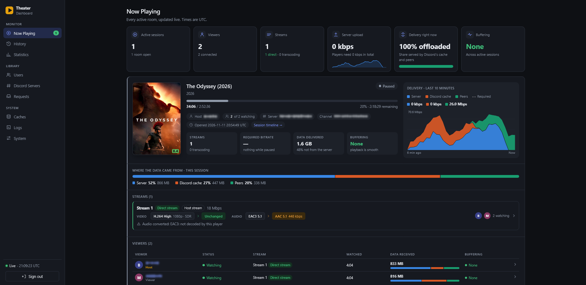
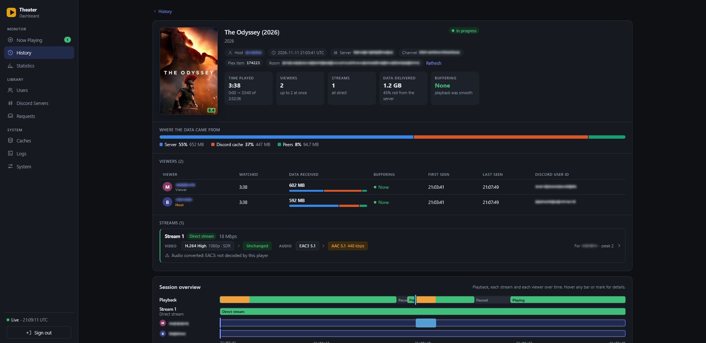

# Dashboard

The Theater dashboard is a web page for the server's owner. It shows what is
playing right now, who is watching, why each stream is sent unchanged or
transcoded, and where the data is coming from. It also keeps a history of
every session, with statistics, users, requests, caches and logs.

It runs on a port of its own, apart from the Activity, and only once you set a
password.



## Turn it on

1. Set `ADMIN_PASSWORD` to a password of 12 characters or more.
2. Publish its port in the compose file:

   ```yaml
   ports:
     - "3000:3000"
     - "3050:3050"
   ```

   Keep this port on your local network: don't forward it on your router or
   route it through your tunnel. To publish it on one address of the server
   only, put that address in front, as in `"<server address>:3050:3050"`.

3. Restart the container. The log says where it listens:

   ```text
   [Admin] dashboard listening url=http://localhost:3050
   ```

4. Open `http://<your server>:3050` and sign in. It opens on Now Playing.

| Setting | Default | Description |
|---|---|---|
| `ADMIN_PASSWORD` | None | Turns the dashboard on, and is its password |
| `ADMIN_PORT` | `3050` | Its port inside the container. It can't be the same as `PORT`. |
| `ADMIN_HOST` | `0.0.0.0` | The address it listens on inside the container |

> [!TIP]
> If your password is in a `.env` file and contains a `$` or a `#`, wrap it in
> single quotes: `ADMIN_PASSWORD='pa$$word#1'`. Docker Compose otherwise reads
> `$name` as a variable, and the password the server gets is not the one you
> typed.

`ADMIN_SECRET` is a different setting: the password for one maintenance
command. See [Configuration Reference](Configuration-Reference#access-and-security).

## Keep it private

- The dashboard is plain HTTP. Keep it on your LAN or a VPN. Don't route it
  through the tunnel or reverse proxy that serves the Activity.
- The Activity's port never serves the dashboard, so Discord's proxy can't
  reach it.
- Each address gets 10 sign-in attempts every 15 minutes. A wrong password is
  logged with the address it came from.
- A sign-in lasts until you sign out, through restarts of the container.
  Changing `ADMIN_PASSWORD` signs everyone out. Each port has its own
  sign-in, so two servers' dashboards on one machine don't sign each other
  out.
- Secrets are never shown. A setting whose name ends in `KEY`, `TOKEN`,
  `SECRET`, `PASSWORD` or similar shows only that it is set. Tokens are removed
  from URLs and from log lines.

## Now Playing

Updated every 2 seconds. The browser tab shows how many sessions are active.

**At the top**

| Tile | Shows |
|---|---|
| Active sessions | Rooms with a title playing, and rooms open |
| Viewers | How many are watching, and how many are connected |
| Streams | How many are direct and how many are transcoding |
| Server upload | What your server is sending right now, with its trend, against what the players need |
| Delivery right now | The share served by Discord's cache and by viewers sharing with each other |
| Buffering | Buffering events across active sessions |

**Each session**

- The title's poster, its name, and whether it is playing, paused or waiting.
  The room waits only for the host's picture, and says why: starting, after
  a seek, or the host changing the audio. Anyone not ready yet catches up
  while it plays.
- A progress bar with the position, the running time and the time left.
- The host, how many are watching, the Discord server and channel by name,
  and when the room opened.
- The bitrate its players need, the data delivered so far, and buffering in
  green, amber or red.
- **Delivery, last 10 minutes.** A live graph of what the players received
  from the server, from Discord's cache and from other viewers, against the
  bitrate they need (the dashed line). Players report every 10 seconds, so
  each point is a 30-second average.
- **Data sources for this session.** The session's total, split the same way.
- **Peer-to-peer sharing for this session.** Who sent video to whom, and how
  much, largest first.

**Each stream** reads at a glance:

- **Direct play**, **Direct stream** or **Transcode**, and its bitrate.
- The video and the audio from source to output. Green means unchanged, amber
  means converted.
- For a transcode, the reason in a sentence.

Select a stream for its details, in four groups: video, audio, delivery and
identifiers. Audio and subtitle tracks show by name, with Plex's number beside.

**Each viewer** shows their role, the client they are on (the Discord desktop
app, the Discord app on a phone, Vesktop, or a browser, and the system), and
their player's state, from what it last
reported: watching, loading (as they start, or after a seek), buffering and
for how long, away or disconnected. Then which stream they are on, how long
they have watched, the data they received with its split, what they sent to
other viewers, and their buffering. Loading is not buffering and isn't counted as it. Select a viewer
for their Discord user ID, quality limit, subtitle track by name, what
their device can play, and their client's user agent as it gave it.

When everyone leaves a room, its session is kept for a short time so the host
can return and continue. When a viewer on a stream of their own leaves, that
stream is kept for a few seconds in case they return. The session says so, by
name, while either is true.

## History

Every session, newest first, each with its poster: the title, when it started,
the host, the Discord server and channel, who watched, how long it played,
whether its streams were direct or transcoded, the data delivered with its
split, and how often it buffered.

Search finds a title, a viewer's name or Discord user ID, or a server or
channel ID. **CSV** and **JSON** export every session the search finds.

Select a session to open it:



| Section | Shows |
|---|---|
| Summary | How it ended and who ended it, time played, viewers, streams, data delivered and buffering, then the data sources |
| Viewers | Each person's role and client, the streams they were on, watch time, data received, data sent to other viewers, and buffering. Select a viewer for their Discord user ID, when they were first and last seen, their role over the session (host, co-host or viewer, and when each began), each client they watched on and when with what that client can play (a viewer who moved from their computer to their phone shows both), and where their data came from and went. A host is in the room before they choose a title, so what they joined on and as is taken from just before the session |
| Streams | Each stream, as on Now Playing |
| Session overview | A chart of the session over time: one row for playback (playing, paused, waiting for the host), one for where in the title it was, one for each stream and one for each viewer, with marks where something changed. Along the foot of each viewer's bar, a gold line shows when they were host and a violet one when they were co-host. The position line is green while playing and dashed while paused; each seek is a step labelled with what made it (Skip Intro, Skip Credits, Jump back, Jump forward), or for one on the seek bar how far it went (Seek +20:00, Seek −5:00), and the end of the title is labelled Finished. Lines across it mark points in the title, labelled on the left: every 5 minutes for an episode, every 30 for a film. Buffering and player errors sit on the position line where they happened, so a bad part of a file shows. Where labels would overlap, as on a phone, some are left to their mark's hover. Hover any bar, line or mark for details. |
| Viewing coverage | One bar per viewer across the whole title, and one for all viewers: the parts they saw, with buffering (a red bar) and player errors (a red diamond) where they happened in the title. Above them, a Seeks row draws each seek as an arc from where it left to where it landed, labelled as on the position line, and a tick where the title finished. |
| Peer-to-peer sharing | Who sent video to whom, and how much, largest first |
| Key moments | The events that explain the session, newest first, each with its reason: a stream starting and why, the host changing a track and who moved with them, a viewer changing stream, quality or subtitles, a change of host or co-host and how it happened, Skip Intro and Skip Credits, a stream ending early, long buffering, and errors. This is where to look when a second stream started part way through. |
| All events | Every event, newest first, with filters for playback, viewers, streams and tracks, and loading, buffering and errors. Each event names who did it and how: a seek says whether it came from Skip Intro, Skip Credits, the jump controls or the seek bar, a viewer moving to another client says from which to which, a change of host says how it happened (handed over; requested and accepted; requested with no answer in time, and whether the host was away from the Discord window; taken back by the host it was passed from; the host leaving, or not coming back in time; the host reconnecting in time), a co-host says who gave or removed it, and a session's end says whether the title finished, the host closed the player, started the next episode or started a different title. Select an event for its details. |

Loading the start of a stream, or after a seek, is shown as loading, not
buffering. History recorded by earlier versions is corrected the first time
the server starts on it.

## Statistics

Trends over the last 24 hours, 7 days, 30 days, 90 days, a year, all time, or
a period of your own under **Custom…**: the last so many hours or days, a
date range (21 September to 1 October, both whole days), or a time range. Three days or less is shown by the hour. Days and hours are
in your local time, and a session counts on the day it started.

- Sessions, watch time, users, data delivered, the share of streams
  transcoded, and buffering.
- Per day: sessions, watch time, data by source, streams direct or
  transcoded, buffering, launches and requests.
- Transcode reasons, the most common first.
- Sessions by hour of the day and by weekday.
- The most watched titles, the most active users, and the most active Discord
  servers.
- The top peer-to-peer sharers, by data sent to other viewers, and the
  largest transfers between two viewers.

**Server upload** is everything the server's port sent in the period: video,
playlists, subtitles and the page, measured as it leaves. The page says since
when.

- In total, on average while something played, at the 95th percentile, and
  in its busiest minute, in Mbps and MiB/s.
- The same by number of viewers, with **Relative to bitrate**: what the
  server sent over the bitrate of the one stream playing. Use it to set the
  qBittorrent manager's `MAX_UPLOAD_MIB`, `MIN_UPLOAD_MIB`,
  `THEATER_SHARED_BASE` and `THEATER_EXTRA_VIEWER_FACTOR`; see
  [qBittorrent Manager API](qBittorrent-Manager-API#setting-it-from-your-own-figures).
- What was sent, and the busiest minute, per hour or day.

**Show table** switches any chart to a table of its numbers.

## Users

Everyone who has used the Activity, most recently active first: their Discord
user ID, sessions, sessions hosted, launches, watch time, data received, data
sent to other viewers, buffering, requests, and the last title they watched.
Select a user for who they sent video to and received it from, the servers and
channels they used, every session they were in, and every title they
requested.

## Discord Servers

Each Discord server the Activity was used in, and each of its channels:
launches, joins, users, sessions and time played. Below, every launch and join,
newest first.

Servers and channels show by name, here and on every page. A server's name is
learned when someone opens the Activity in it, and a channel's when the
Activity runs in it. Until then the ID shows; hover a name for its ID. To
match an ID yourself, turn on Developer Mode in Discord, then right-click the
server or channel and choose **Copy ID**.

## Requests

Every title requested through Seerr from the Activity: who asked, the title,
the seasons, and the result. **Status now** asks Seerr for the request's
current state, so a request that was approved, declined or filled since it was
made shows as such.

## Caches

- **Storage used.** The total size of everything the server stores, and each
  cache's size, share of the total, limit and number of items, largest first.
- **Discord cache efficiency.** How much of the video players downloaded was
  served by Discord's cache instead of your server, over the last day, the
  last week and all time, and for each title.
- **Each cache the server keeps**, with its size against its limit, where it
  is, how long things are kept, and what it holds: video being played, artwork,
  title details, subtitles, seek-bar previews and subtitle fonts.

## Logs

The server's log files, newest first. Filter by level, tag or text, and show
the last 200 to 5000 lines. **Follow** refreshes every 5 seconds. Lines
reported by a viewer's player are labelled with that player. Times are in
your local time; each file holds one day in UTC.

## System

- **Status.** Version, uptime, memory and platform.
- **History database.** Where `admin.sqlite` is, its size, what it holds and
  the period it covers. **Download database** saves a copy. **Delete old
  history** deletes everything older than the number of days you enter:
  **Preview deletion** shows what would go, and nothing is deleted until you
  confirm. Sessions in progress are never deleted.
- **Configuration.** Every environment setting the server reads, grouped by
  area. They are shown for reference. To change one, edit your compose file
  or `.env` and restart the container.

## What is recorded

While the dashboard is on, the server records into `admin.sqlite`, in the data
folder:

- **Each session:** a title played in a room, from start to end, with where in
  Discord it was, who hosted it, and how it ended.
- **Each viewer of a session:** how long they watched, the data their player
  received and where from, their buffering, and their player's errors.
- **Each stream:** direct or transcoded and why, its tracks, quality and
  bitrate, who it was made for, and when it started and ended.
- **Each event:** plays, pauses and seeks with who did them, people joining
  and leaving, track and quality changes, buffering and errors.
- **Where in the title:** the room's position, and each player's, every 10
  seconds.
- **Usage:** each launch of the Activity and each person joining a room.
- **Upload:** what the server's port sent, each minute, with how many were
  watching and the bitrate of the streams playing.
- **Names:** the names of Discord servers and channels.
- **Requests:** each title requested through Seerr.

Nothing is deleted unless you delete it on the System page. Without
`ADMIN_PASSWORD`, nothing is recorded. Back up `admin.sqlite` with the rest of
the data folder. See [Updating and Backups](Updating-and-Backups).

## Exports and API

A signed-in browser can read everything as files or JSON.

| Path | Returns |
|---|---|
| `/api/overview` | Every room right now |
| `/api/history` | Sessions, newest first. `?q=` searches. `?before=<id>` is the next page. |
| `/api/history/<id>` | One session: its viewers, streams and events |
| `/api/people`, `/api/people/<id>` | Users, and one user |
| `/api/places` | Each Discord server and its channels |
| `/api/names` | The names of Discord servers and channels, by ID |
| `/api/usage` | Launches and joins, newest first |
| `/api/requests` | Title requests, with Seerr's current status |
| `/api/caches` | Each cache and what it holds |
| `/api/graphs` | Statistics by hour or day, and the server's upload. `?days=` is the period: 30 unless given, 0 for all time. `?hours=` is the last so many hours instead, and `?from=` with `?to=`, in milliseconds since 1970, a period of its own. `?tz=` is the time zone the days, hours and weekdays are in, such as `Europe/London`: UTC unless given. |
| `/api/export/<list>.csv`, `.json` | `history`, `people`, `usage` or `requests`, as a file. `?q=` is the list's search. At most 200,000 rows. |
| `/api/export/admin.sqlite` | A copy of the whole history database |

CSV files are UTF-8 and open in a spreadsheet. Text that a spreadsheet would
run as a formula is written with a `'` in front.

## Next

→ [Configuration Reference](Configuration-Reference)
