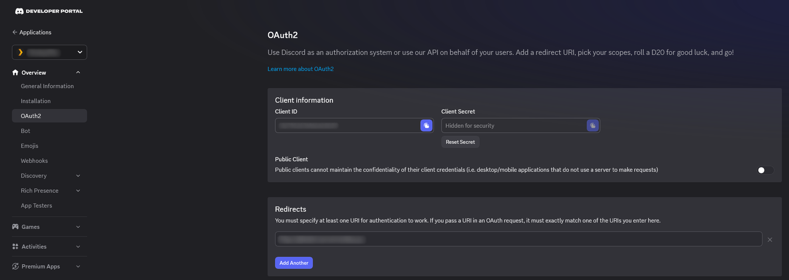
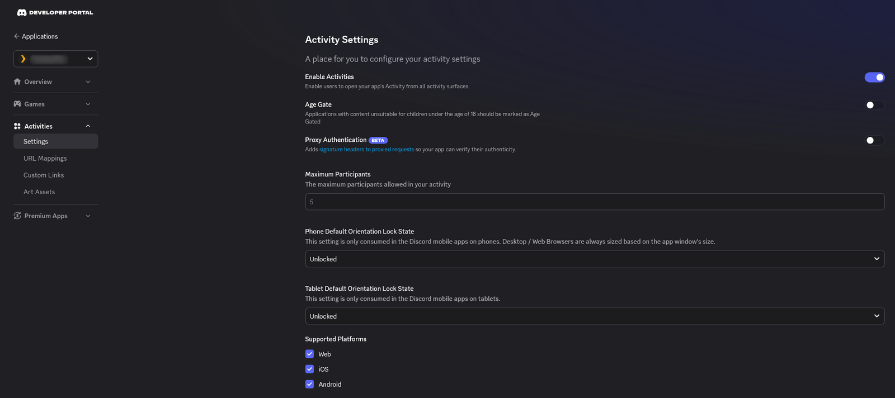
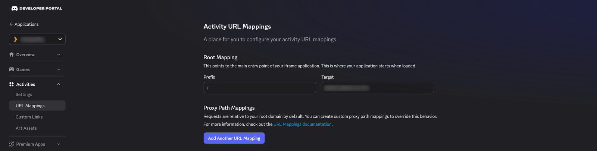
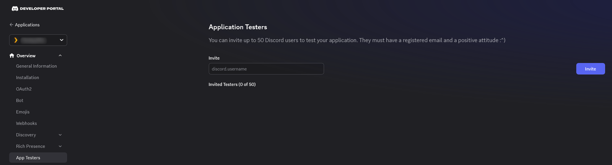

# Discord Application Setup

The Activity runs as your own Discord application. On this page you create the
application, enable Activities, point Discord at your server, keep the
application private, and add the people who will watch.

Step 4 needs the public host name the server will use, for example
`watch.example.com`. If you haven't chosen it yet, see
[HTTPS and Reverse Proxy](HTTPS-and-Reverse-Proxy) first, or complete the other
steps now and return to step 4.

## 1. Create the application

1. Open the [Discord Developer Portal](https://discord.com/developers/applications)
   and select **New Application**.
2. Enter a name. This is the name people see in Discord's list of Activities,
   for example "Movie Night".
3. On **General Information**, copy the **Application ID**. This is
   `DISCORD_CLIENT_ID`.

The Application ID isn't secret. It appears in every sign-in request and is
sent to every viewer's browser.

## 2. Copy the client secret

1. Select **OAuth2** in the sidebar.
2. Under **Client Secret**, select **Reset Secret**, confirm, and copy the
   value. This is `DISCORD_CLIENT_SECRET`.

Discord shows the secret only once. If you lose it, reset it again and update
the server's settings.

> [!WARNING]
> Keep the client secret private: out of commits, issues and screenshots.
> Anyone who has it can act as your application.

## 3. Enable Activities

1. Select **Activities → Settings**.
2. Turn on **Enable Activities**.

## 4. Map the URL

Discord loads the Activity through its own proxy, which forwards requests to
the host you map here.

1. Select **Activities → URL Mappings**.
2. Set the **Root Mapping**:

   | Prefix | Target |
   |---|---|
   | `/` | `watch.example.com` |

Enter your public host name without `https://`. It must be the same host you
use in `REDIRECT_URI` and `ALLOWED_ORIGINS`.

If you will use the [VPS Relay](VPS-Relay), also select **Add Another URL
Mapping** and add the relay's host:

| Prefix | Target |
|---|---|
| `/theater` | `relay.example.com` |

Without this mapping, Discord's proxy blocks the video segments the relay
serves.

## 5. Keep the application private

By default, anyone with an install link can add your application to their own
servers. For a personal Plex server, turn that off:

1. Select **Installation** and set **Install Link** to **None**.
2. Select **Bot** and turn **Public Bot** off.

With **Public Bot** off, only you can install the application.

> [!IMPORTANT]
> Discord lets you turn **Public Bot** off only while the application is
> unverified and **Install Link** is **None**, which is why the install link
> comes first. A verified application can't be made private. See
> [Private or verified](#private-or-verified).

## 6. Add your viewers as app testers

An unverified application can be launched only by its developer team and by
app testers. Add everyone who will watch:

1. Select **App Testers**.
2. Enter each person's Discord username and send the invitation.

Each person must accept the invitation. Until they do, the Activity doesn't
appear for them.

## Values for the server

| From the portal | Server setting |
|---|---|
| Application ID | `DISCORD_CLIENT_ID` |
| Client Secret | `DISCORD_CLIENT_SECRET` |
| The host you mapped, with `https://` in front | `REDIRECT_URI` and `ALLOWED_ORIGINS` |

---

## Limits of an unverified application

Until the application is verified, Discord applies these limits:

- It can be launched only in servers with fewer than 25 members, and in DMs
  and group DMs.
- Only your developer team and app testers can launch or join it.

For a group of friends, a private server with fewer than 25 members works
well.

## Verifying the application

Verification removes the member limit, and lets anyone in a server where the
application is installed use it. It is also required once an application is in
more than 100 servers.

1. Open the application and select **App Verification**.
2. Complete every item on the checklist.
3. Select **Verify App**.

Verification includes an identity check of the team owner through Stripe,
which needs a government-issued ID, and a description of what the application
does and how it handles data.

### Private or verified

| | Unverified and private | Verified |
|---|---|---|
| Who can install it | Only you | Anyone; it can't be made private |
| Server size | Fewer than 25 members | No limit |
| Who can launch it | Your team and app testers | Anyone in a server where it is installed |
| Effort | Two settings | Identity check and review |

For a small group, stay unverified and private. For a larger server, verify the
application and set [`ALLOWED_GUILD_IDS`](Configuration-Reference#access-and-security)
so your server accepts only your own Discord servers.

## Permissions the Activity requests

The first time someone opens the Activity, Discord asks them to authorize
three scopes:

| Scope | Used for |
|---|---|
| `identify` | Their user ID and display name, so the room knows who is who |
| `guilds` | The servers they belong to, so `ALLOWED_GUILD_IDS` can be enforced |
| `rpc.activities.write` | Showing what they are watching on their Discord profile. Playback works without it. |

The application doesn't read or send messages, and has no moderation
permissions.

## Discord's documentation

- [What are Verified and Unverified Activities?](https://support-dev.discord.com/hc/en-us/articles/26576097154199-What-are-Verified-and-Unverified-Activities)
- [How Can Users Discover and Play My Activity?](https://support-dev.discord.com/hc/en-us/articles/21204493235991-How-Can-Users-Discover-and-Play-My-Activity)
- [How Do I Get My App Verified?](https://support-dev.discord.com/hc/en-us/articles/23926564536471-How-Do-I-Get-My-App-Verified)

## Next

→ [Plex Setup](Plex-Setup)
