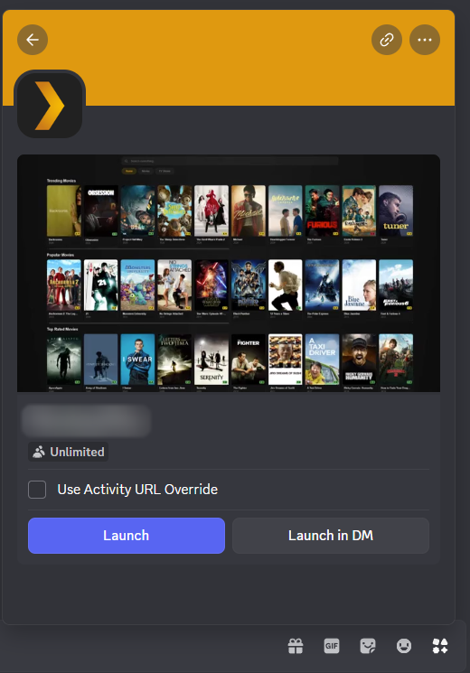

# First Launch

On this page you open the Activity in Discord for the first time, invite
viewers, and confirm that playback and sync work.

## 1. Open the Activity

1. In Discord, open a voice or text channel in your server. Nobody needs to be
   in a voice call.
2. Open the **App Launcher**: the rocket icon in a voice channel's controls,
   or beside the message box in a text channel.
3. Select your application.

The first time, Discord asks you to authorize the Activity. After that, the
home screen shows your Plex libraries.

While the application is unverified, it appears only in servers with fewer than
25 members, and only for your developer team and app testers. See
[Discord Application Setup](Discord-Application-Setup#limits-of-an-unverified-application).

## 2. Invite viewers

Everyone who opens the Activity in the same channel joins the same room. To
bring people in, use the Activity's **Invite** button, or Discord's own
**Invite to Activity**. People who are already in the channel can also open the
Activity from the App Launcher.

Each viewer must be an app tester who has accepted the invitation, unless the
application is verified.

## 3. Play something

The person who opened the Activity first is the host. As host, open a title and
select **Play**. Everyone in the room starts playing it at the same position,
and anyone who joins later starts where the room is.

From here:

- [Using the Activity](Using-the-Activity) covers the library, the player and
  the settings.
- [Roles and Permissions](Roles-and-Permissions) explains what the host,
  co-hosts and viewers can each do.

## Check that everything works

Work down this list. Each check depends on the one above it.

| Check | How | If it fails |
|---|---|---|
| The Activity is listed | It appears in the App Launcher | [The Activity does not appear](Troubleshooting#the-activity-does-not-appear-in-the-app-launcher) |
| It loads | The home screen shows your libraries | [The library is empty](Troubleshooting#the-library-is-empty) |
| A title plays | Video and sound start within a few seconds | [A title does not play](Troubleshooting#a-title-does-not-play) |
| The room is in sync | A second person sees your pauses and seeks | [Stuck on Reconnecting](Troubleshooting#stuck-on-reconnecting) |
| Optional features work | Pages for titles outside your library show a description | [Discover pages have no description](Troubleshooting#discover-pages-have-no-description) |

## Next

Setup is complete. To adjust bitrates, add integrations or enable the FFmpeg
engine, continue with the [Configuration Reference](Configuration-Reference).
