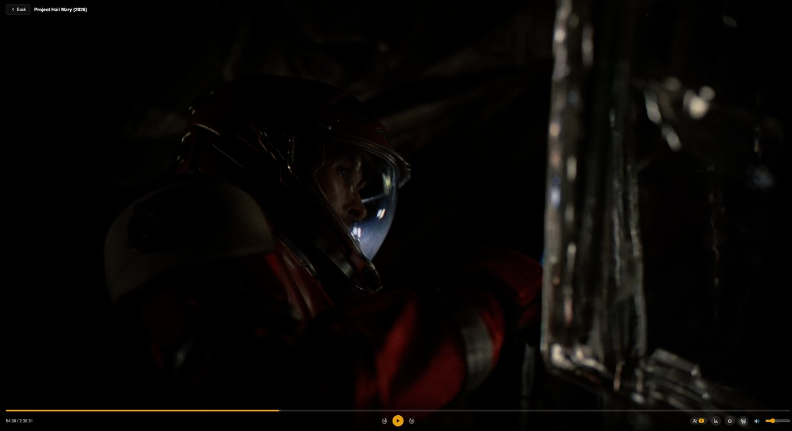

# Plex Discord Theater

Plex Discord Theater is a Discord Activity for watch parties from your own Plex
Media Server. One person hosts, playback stays in sync for everyone in the
room, and each viewer chooses their own audio track, subtitles and quality.

The server runs in Docker on your network. It signs viewers in with Discord,
passes every Plex request and video segment through itself, and keeps each
room in sync. Plex tokens never reach a viewer's browser.

## Set up

Work through these pages in order. Each one ends with a link to the next.

| Step | Page | What you do |
|---|---|---|
| 1 | [Requirements](Requirements) | Check the server, network and bandwidth you need |
| 2 | [Discord Application Setup](Discord-Application-Setup) | Create the Discord application and enable Activities |
| 3 | [Plex Setup](Plex-Setup) | Collect the Plex tokens and check Plex's settings |
| 4 | [HTTPS and Reverse Proxy](HTTPS-and-Reverse-Proxy) | Give the server a public HTTPS address |
| 5 | [Installation](Installation) | Deploy the container and confirm it works |
| 6 | [First Launch](First-Launch) | Open the Activity in Discord and invite viewers |

## Configure

| Page | Covers |
|---|---|
| [Configuration Reference](Configuration-Reference) | Every setting, with its default |
| [Streaming and Quality](Streaming-and-Quality) | How streams are made, bitrates, and what each viewer receives |
| [FFmpeg Engine](FFmpeg-Engine) | Making streams in the container instead of in Plex |
| [Optional Integrations](Optional-Integrations) | Plex Discover, TMDB, TVDB and Seerr |
| [qBittorrent Manager API](qBittorrent-Manager-API) | Sharing upload bandwidth with qBittorrent |

## Use

| Page | Covers |
|---|---|
| [Using the Activity](Using-the-Activity) | Browsing, the player, settings and picture-in-picture |
| [Roles and Permissions](Roles-and-Permissions) | What hosts, co-hosts and viewers can do |
| [Personal Plex Sync](Personal-Plex-Sync) | Linking a Plex account for history and Watchlist |
| [Requesting Titles](Requesting-Titles) | Requesting films and seasons through Seerr |

## Maintain

| Page | Covers |
|---|---|
| [Updating and Backups](Updating-and-Backups) | Updating, the data volume, backup and restore |
| [Admin Page](Admin-Page) | What is playing, for whom and why, live; history, people, servers, requests, caches, logs and settings |
| [Local Development](Local-Development) | Running from source and contributing |
| [Troubleshooting](Troubleshooting) | Symptoms, causes and fixes |
| [FAQ](FAQ) | Short answers to common questions |

> [!WARNING]
> This project was developed primarily with AI-assisted tooling and has not had
> an external security review. Run it on infrastructure you control, for people
> you know, and don't offer it as a public service.
