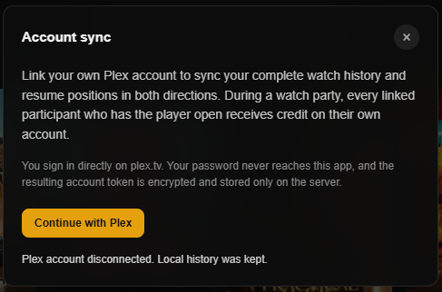
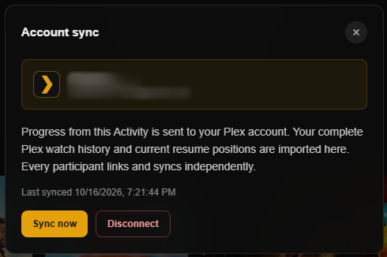
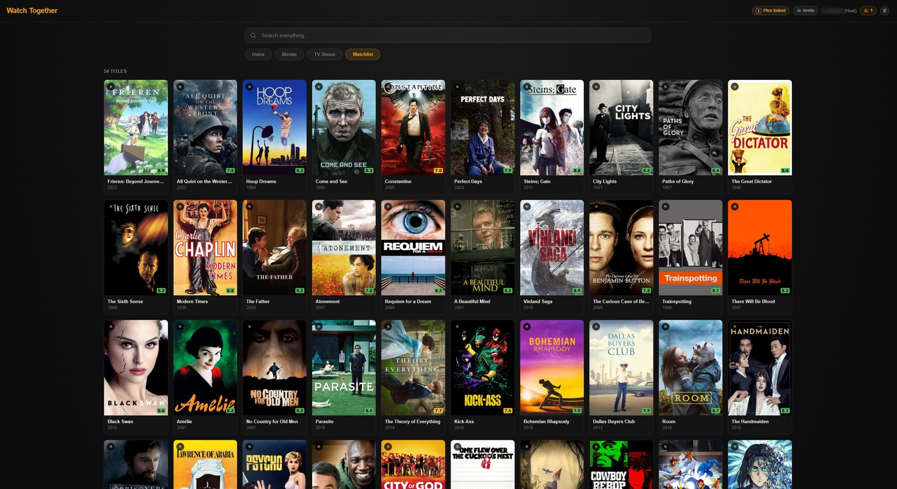

# Personal Plex Sync

Linking your own Plex account is optional. It makes what you watch in the
Activity count in your own Plex account, as if you had watched it in a Plex
app. You don't need it to watch anything.

## What it does

The Activity always streams through the server owner's Plex server. Linking
your account doesn't change that: it gives the Activity access to your own
watch data while you watch on their server.

Once linked, these stay in step with your Plex account:

| Synced | Details |
|---|---|
| Watched status | Titles you finish here are marked watched in Plex, and what you have watched elsewhere shows as watched here |
| Resume points | Stop part-way and Plex remembers where; titles you started elsewhere resume here |
| Continue Watching | The Home row follows your Plex account |
| Watchlist | A **Watchlist** tab shows your Plex Watchlist, and films and shows have **Add to Watchlist** on their pages |

People who haven't linked an account aren't left out: the Activity keeps their
watched status and history itself.

## Link your account

1. Select **Link Plex** in the header.
2. Select **Continue with Plex**.
3. Sign in on Plex's own page, which opens in your browser.

Your Plex password goes only to Plex. The Activity receives an access token,
which the server stores encrypted.

When you link, the Activity imports your Plex watch history. After that it
syncs on its own, and **Sync now** in the same panel syncs straight away.

## What changes once you link

- The **History** tab is replaced by a **Watchlist** tab. Your progress is
  still shown, through Continue Watching and each title's watched status.
- **Mark watched** and **Mark unwatched** change your Plex account as well.
- While you watch, your progress is saved to Plex every 15 seconds or so, so
  you can stop in Discord and resume in any Plex app.

## In a watch party

Everyone in the room who has linked an account gets the progress in their own
Plex account, not only the host. Four linked people watching an episode
together all have it marked watched.

A title counts as watched when its credits start. A title without a credits
marker counts as watched past the Plex server's **Video played threshold**
(Plex's **Settings → Library**, 90% by default).

To keep parties you join as a viewer out of your Plex account, choose **Only
when I host** under **Settings → Watch history**.

## Link a different account

Your Activity history belongs to the Plex account that produced it. Linking a
different Plex account clears the history the Activity kept for you, so none
of it is copied into the new account. Linking the same account again keeps it.

## Disconnect

1. Select **Plex linked** in the header.
2. Select **Disconnect**, then **Yes, disconnect**.

The server deletes your token. Whatever was already saved to your Plex account
stays there.

If you change your Plex password or sign out of all devices in Plex, the
server can no longer use your token. The header returns to **Link Plex**, with
a note to link again.

## For administrators

Tokens are encrypted with a key derived from `PLEX_LINK_SECRET`. When that
isn't set, the key comes from `DISCORD_CLIENT_SECRET`, and failing that from
`PLEX_TOKEN`. Changing whichever value is in use makes the stored tokens
unreadable, and everyone has to link again. Set `PLEX_LINK_SECRET` once and
keep it. See [Configuration Reference](Configuration-Reference#plex-accounts).

## Next

→ [Requesting Titles](Requesting-Titles)
