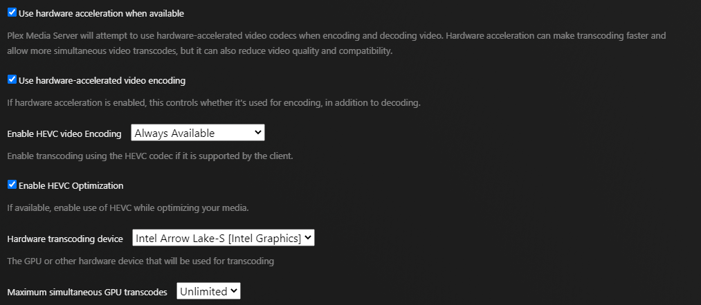
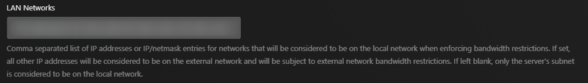
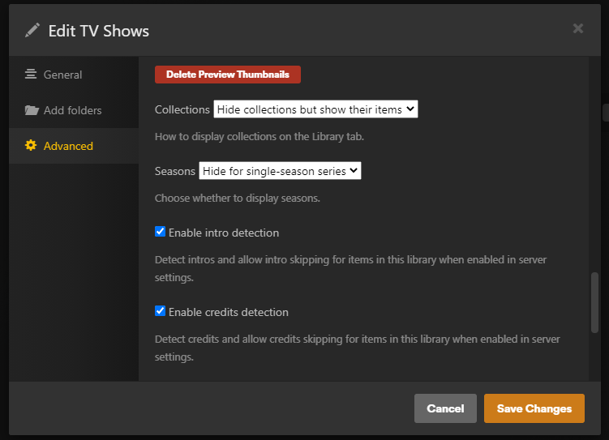

# Plex Setup

On this page you collect the Plex credentials the server needs, choose the
address it uses to reach Plex, and check the Plex settings that affect
playback.

## Plex credentials

| Credential | Belongs to | Required | Used for |
|---|---|---|---|
| `PLEX_TOKEN` | The server owner | Yes | Browsing the library and making streams |
| `PLEX_ACCOUNT_TOKEN` | The server owner's plex.tv account | Recommended | Pages for titles that aren't in your library (Plex Discover), and signing in to Seerr |
| Linked accounts | Each viewer | Optional | Each viewer's own watch history, resume points and Watchlist. See [Personal Plex Sync](Personal-Plex-Sync). |

`PLEX_TOKEN` is a token for your server, and Plex's online services reject it.
Without `PLEX_ACCOUNT_TOKEN`, search still finds titles outside your library,
but their pages have no description or cast.

Use the server owner's token for `PLEX_TOKEN`. Besides playback, the server
uses it to remove its own streams from Plex's **Now Playing** and to stop
streams nobody is watching, which only the owner can do.

### Get PLEX_TOKEN

Plex explains this in
[Finding an authentication token](https://support.plex.tv/articles/204059436-finding-an-authentication-token-x-plex-token/).
In short:

1. In Plex Web, open any item in your library.
2. Select **⋯ → Get Info → View XML**.
3. In the address of the page that opens, copy the value after
   `X-Plex-Token=`.

### Get PLEX_ACCOUNT_TOKEN

Plex Web sends the account token only with requests to Plex's online services,
so you find it by opening a title that is **not** in your library:

1. Sign in at [app.plex.tv](https://app.plex.tv).
2. Open the browser's developer tools (**F12**, or **Cmd+Option+I** on a Mac)
   and select the **Network** tab.
3. Search Plex for a film you don't have, and open its page. If the Network
   list is empty, reload the page.
4. Type `provider.plex.tv` in the Network panel's filter box. The requests that
   remain go to Plex's online services.
5. Select any of them. Under **Headers**, find `X-Plex-Token` in the request
   URL or the request headers. Its value is the account token.

In Safari, first turn on **Safari → Settings → Advanced → Show features for
web developers**, then use **Develop → Show Web Inspector → Network**.

As an alternative, run this in the developer tools' **Console** on
app.plex.tv. If it prints `null`, use the steps above.

```js
localStorage.getItem("myPlexAccessToken")
```

To check the token after installation, search the Activity for a title you
don't own and open it. A description and cast mean the token works.

The account token stops working when you sign out of all devices, or change
your Plex password and sign devices out. If Discover pages or requests stop
working, get a new token the same way.

> [!WARNING]
> `PLEX_TOKEN` gives full access to your server, and `PLEX_ACCOUNT_TOKEN` to
> your whole Plex account. Keep both out of screenshots, issues and commits.

## Choose PLEX_URL

`PLEX_URL` is the address the container uses to reach Plex. It is often
different from the address you use in your browser.

| Your setup | PLEX_URL |
|---|---|
| Plex on another machine | Its LAN address, for example `http://192.168.1.50:32400` |
| Plex in Docker on the same host, on a shared Docker network | The Plex container's name, for example `http://plex:32400` |
| Plex on the same host, not in Docker | The host's LAN address, or `http://host.docker.internal:32400` |

> [!IMPORTANT]
> Don't use `http://localhost:32400`. Inside the container, `localhost` is the
> container itself, not your Plex server.

After installation, this command checks the address from inside the container.
An XML reply means the container reaches Plex.

```bash
docker exec plex-discord-theater node -e "fetch(process.env.PLEX_URL + '/identity').then(r => r.text()).then(console.log, console.error)"
```

## Plex settings

### Transcoder

Plex makes the streams unless you use the [FFmpeg engine](FFmpeg-Engine), so
its transcoder must work. Under **Settings → Transcoder**:

- Turn on **Use hardware acceleration when available** if you have Plex Pass
  and a supported GPU. Without it, one 1080p re-encode can occupy several CPU
  cores.
- Turn on **Enable HEVC video encoding** for sharper re-encodes for players
  that decode HEVC (`HEVC_TRANSCODE`, on by default). It needs Plex Pass and
  hardware HEVC encoding; without it, Plex sends H.264. Copying HEVC files
  needs neither.



With Direct Stream, on by default, Plex copies the video whenever the player
can decode it and converts only the audio, which costs very little. The
transcoder is still needed for re-encodes; see
[Streaming and Quality](Streaming-and-Quality).

With the FFmpeg engine, the container makes the streams, and Plex's transcoder
runs only for the streams the engine leaves to Plex. Keep it working for those.

### LAN Networks

Plex treats the server as a remote player, and applies your remote streaming
limits to it, unless the network it connects from is listed under
**Settings → Network → LAN Networks**. Plex's log shows `(WAN)` next to its
requests when that happens.

Add the network the container connects from: the Docker network's subnet, or
your LAN's subnet if the container uses the host network.



### Intro and credits markers

**Skip Intro** and **Skip Credits** appear only for episodes and films where
Plex has detected markers.

- Under **Settings → Library**, set **Generate intro video markers** and
  **Generate credits video markers** to run.
- In each library, under **Edit → Advanced**, turn on **Enable intro
  detection** and **Enable credits detection**.

Detection runs as a scheduled task and takes time on a large library. The
buttons appear as it completes.



Markers also decide when a title counts as watched: at its first credits
marker, or for a title without one, at your server's **Video played
threshold** (**Settings → Library**, 90% by default).

### Preview thumbnails

The pictures shown while you drag the seek bar come from Plex's video preview
thumbnails. Turn on **Generate video preview thumbnails** under **Settings →
Library**. Generating them takes time and disk space; without them, seeking
works but shows no pictures. The [FFmpeg engine](FFmpeg-Engine#seek-bar-previews)
makes previews itself for files that have none.

For a long film, the player loads preview pictures in stages, so seeking shows
pictures almost at once without interrupting playback.

### With the FFmpeg engine

- **Library paths.** The engine opens each file at the path Plex reports for
  it. Mount the library into the container at the same path, or map Plex's
  paths to yours with [`MEDIA_PATH_MAP`](FFmpeg-Engine#2-map-the-library-paths).
- **Plex's dashboard.** The engine's streams appear in Plex as **Direct Play**
  on the server owner's account. Stop them from the Activity; Plex can't stop
  them. See [FFmpeg Engine](FFmpeg-Engine#plex-dashboard-tautulli-and-tracearr).

## Next

→ [HTTPS and Reverse Proxy](HTTPS-and-Reverse-Proxy)
