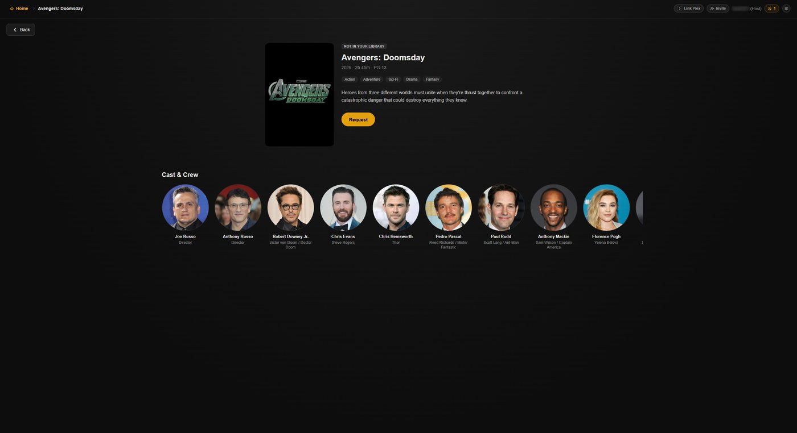
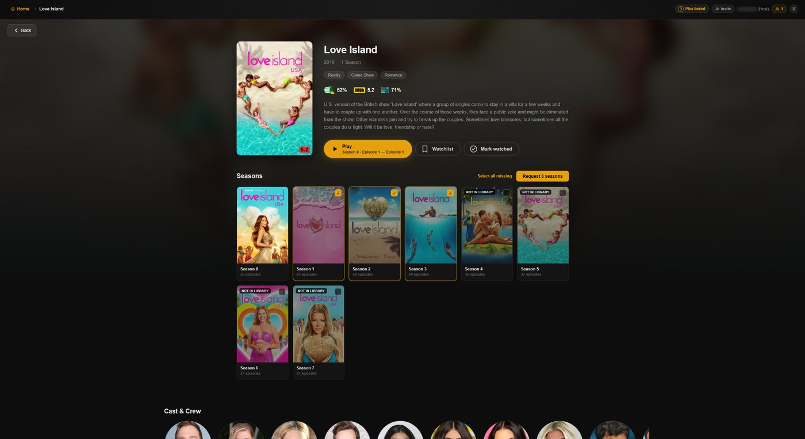
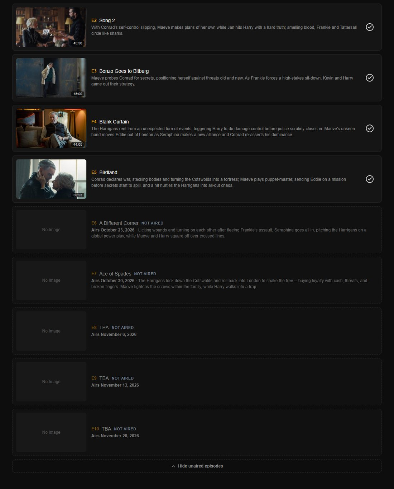

# Requesting Titles

When the server owner has connected Seerr (Overseerr or Jellyseerr), anyone
in the Activity can request films and shows that aren't in the library,
without leaving Discord. Setting it up is covered in
[Optional Integrations](Optional-Integrations#seerr).

## Find titles that are not in the library

Search covers the library and Plex Discover together. Titles the server
doesn't have are marked **Not in library**.

They also appear in:

- **Also in this collection**, on a film's page
- **More Like This**
- **Cast and crew** pages, in each person's wider filmography
- **Season** pages, as missing seasons and episodes

## Request a film

Open the film and select **Request**. The button then shows the request's
status: **Requested**, **Processing** or **Available**.

## Request seasons of a show

1. Open the show. Seasons the server doesn't have appear in the season grid,
   dimmed, with a checkbox.
2. Select the seasons you want, or **Select all missing**.
3. Select **Request seasons**.

Each season shows its status, so nothing is requested twice:

| Badge | Meaning |
|---|---|
| **Requested** | Waiting for approval or to be found |
| **Processing** | Approved and being downloaded |
| **Partial** | Some episodes are in the library |
| **In library** | Available to play |

A season that has been announced but has no air date or episodes yet can't be
requested, because there is nothing to download.

## What happens next

The request goes to the server owner's Seerr and follows its rules: it may be
approved automatically or wait for approval. When the title arrives in Plex, it
plays like anything else in the library.

All requests are made through the server owner's Seerr account. Seerr can't
tell who asked, so per-user quotas and notifications don't apply.

## Missing and upcoming episodes

Season pages list every episode, including those the server doesn't have, with
air dates for episodes that haven't aired yet.

With a TVDB key set, episodes follow the same numbering as Sonarr. TVDB and
TMDB sometimes put an episode in different seasons, and Sonarr downloads by
TVDB's numbering.

## When requests do not work

| Problem | Cause |
|---|---|
| No **Request** button anywhere | `SEERR_URL` isn't set |
| **Request failed** | Seerr couldn't be reached, or it refused the sign-in. Check that the account behind `PLEX_ACCOUNT_TOKEN` (or `PLEX_TOKEN`) can sign in to Seerr. |
| Pages for titles not in the library have no description | `PLEX_ACCOUNT_TOKEN` isn't set |
| Missing episodes are numbered differently from Sonarr | `TVDB_API_KEY` isn't set |

## Next

→ [Updating and Backups](Updating-and-Backups)
