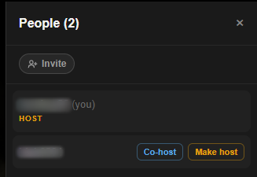
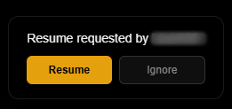
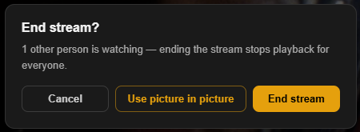

# Roles and Permissions

Each room has one host, any number of co-hosts, and viewers. This page lists
what each role can do and how the host role moves between people.

## What each role can do

| | Host | Co-host | Viewer |
|---|---|---|---|
| Play and pause the room | ✅ | ✅ | — |
| Seek | ✅ | ✅ | — |
| Skip intro and credits | ✅ | ✅ | — |
| Change episode, or play the next queued title | ✅ | ✅ | — |
| Start a different title | ✅ | — | — |
| Manage the queue | ✅ | — | — |
| Make or remove co-hosts | ✅ | — | — |
| Hand over the host role | ✅ | — | — |
| End the stream for everyone | ✅ | — | — |
| Move everyone on their tracks to new audio or subtitles | ✅ | — | — |
| Choose their own audio, subtitles, quality and volume | ✅ | ✅ | ✅ |
| Suggest a title | ✅ | ✅ | ✅ |
| Ask for a pause or resume | ✅ | ✅ | ✅ |
| Stats for nerds | ✅ | ✅ | ✅ |

Co-hosts control the title that is playing; the host decides which title plays.
A co-host's episode change is carried out by the host's player.

## Who is host

The person who opens the Activity first in a channel is the host. After that,
the role moves in four ways.

### The host hands it over

The host opens the people list and selects **Make host** beside someone. The
same list makes people co-hosts, up to 50 per room.

### Someone asks for it

A host who stays in the Activity but walks away leaves everyone else unable
to play or pick anything. Anyone else can select **Request host** at the
foot of the people list. The host sees who asked and a countdown, with
**Accept** and **Decline**, on a card over the page and in the people list.
If the host doesn't answer in 5 minutes, the role passes to the person who
asked. Only the host's own **Decline** declines: nothing else they do in the
Activity answers for them.

- **The host is away:** the countdown is 1 minute, and drops to 1 minute if
  the host goes away while it runs. Away means the Activity has been hidden
  for 30 seconds, or nothing has been touched for 7 minutes, whether or not
  the film is playing. Discord's own idle status can't be read by an Activity.
- **One request at a time:** everyone else sees who asked and the time left.
- **The host declines:** nobody
  can ask for 15 minutes, and the person who asked can't ask again for 2 hours.
  A person who can't ask sees how long is left when they select the button.
- **The role passes on:** nobody can ask the new host for 15 minutes. A host
  who lost the role to the countdown can select **Reclaim host** within
  10 minutes.
- **Who asked leaves, or the role moves another way:** the request ends.

The person who asked can minimize or hide the countdown, and reopen it from
the people list. All of this belongs to one Activity: a new one, after
everyone leaves or in another channel, starts fresh. Set `HOST_REQUESTS=off`
to turn it off.

### The host leaves

When the host leaves, the room promotes someone straight away, in this order:

1. Someone watching the same stream as the host, so nobody's playback
   restarts
2. A co-host
3. Someone who is watching
4. Whoever joined earliest

### The host comes back

- **Within 15 seconds:** a host who drops out briefly, for example on a
  connection blip or a pop-out, gets the host role back.
- **Within 30 seconds, in a new Activity window:** when the host closes the
  Activity and opens it again in the same channel while the room is empty,
  the room and its stream carry over to the new window.

## Co-hosts

Two common uses:

- **Breaks.** Someone else can pause without waiting for the host.
- **Series nights.** Whoever is most awake moves to the next episode.

Co-hosts can't start a different title, manage the queue or change roles, so
nobody can take over the room by being given pause rights.

## Asking for a pause

Every viewer has a raised-hand button in the control bar. It sends the host and
co-hosts a card asking them to pause or resume.

- It never pauses anything by itself.
- Only people who can act on it see the card.
- A viewer can send one request every 5 seconds.
- The card disappears after a while if nobody acts on it.

## Roles and streams

Being host is about who controls the room. Streams are separate: a room can
have several at once, one for each combination of audio track, burned-in
subtitle and quality that someone is watching, and each is kept running by
one of the people watching it.

When that person leaves, someone else on the same stream takes it over, so a
host change doesn't restart anybody's stream. A viewer's own stream is kept
for 15 seconds after they leave, so a quick reconnect continues it. A stream
nobody watches is stopped after 5 minutes.

## Ending the stream

The host ends the stream for everyone with **End stream**, which stops it on
the server and returns everyone to the library.

The host's **Back** button also ends it in two cases: when the title has
finished, and when the host is watching alone and has played less than a
quarter of it. With others watching, **Back** asks first, offering **Use
picture in picture** or **End stream**. Closing picture-in-picture works the
same way. See [Picture-in-picture](Using-the-Activity#picture-in-picture).

If everyone closes the Activity, the room is kept for 30 seconds in case
someone comes back, and its streams are then stopped.

## Next

→ [Personal Plex Sync](Personal-Plex-Sync)
