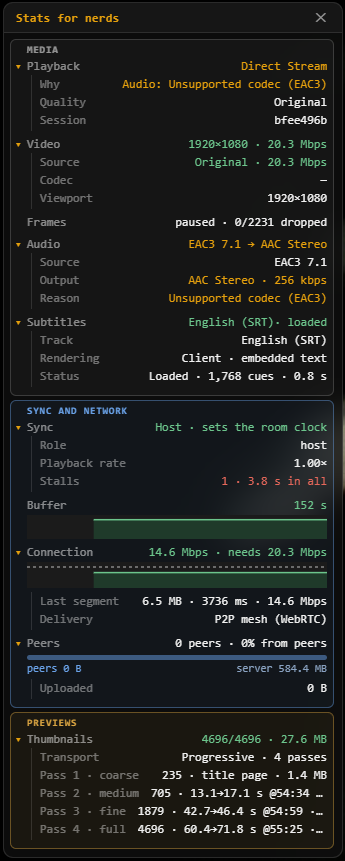
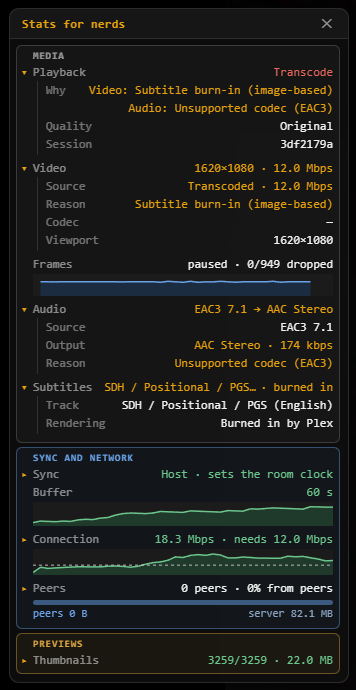
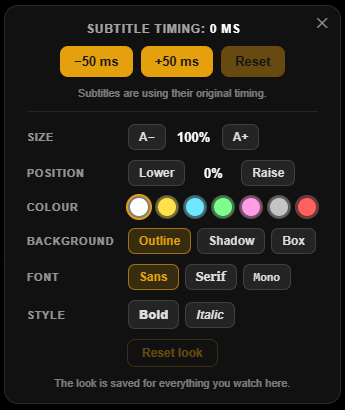

# Troubleshooting

Find the section for where the problem appears. Two commands answer most
questions:

```bash
docker compose ps
docker compose logs | grep '\[Config\]'
```

The first shows whether the container is running and healthy. The second shows
the startup summary: which features are on, and why any are off.

| Section | Covers |
|---|---|
| [Setup and startup](#setup-and-startup) | The container, its health check and Plex connection |
| [Discord](#discord) | The App Launcher, blank pages, presence |
| [Library and title pages](#library-and-title-pages) | Empty library, missing descriptions, ratings, requests |
| [Playback](#playback) | Titles that don't play, buffering, copies and re-encodes, subtitles |
| [Rooms and connection](#rooms-and-connection) | Reconnecting, expired sessions, sync |
| [FFmpeg engine](#ffmpeg-engine) | The GPU, library paths, previews, Plex's dashboard |
| [VPS relay](#vps-relay) | Relay errors |
| [Logs](#logs) | Collecting logs, and reporting a problem |

## Setup and startup

### The container does not start

Read its last log lines:

```bash
docker compose logs --tail 50
```

| The log or Docker says | Fix |
|---|---|
| `Missing required environment variable: …` | Set all six required values: `DISCORD_CLIENT_ID`, `DISCORD_CLIENT_SECRET`, `PLEX_URL`, `PLEX_TOKEN`, `REDIRECT_URI` and `ALLOWED_ORIGINS`. See [Configuration Reference](Configuration-Reference#required). |
| Port 3000 is already allocated | Another program uses port 3000. Change the host side of the port mapping, for example `3001:3000`, and point your proxy or tunnel at the new port. |
| A build error in `better-sqlite3` (building from source) | Give Docker more memory, and build again. |

### The container is unhealthy or keeps restarting

The health check asks the server whether it can reach Plex. `unhealthy` almost
always means `PLEX_URL` is wrong from inside the container. Test it there:

```bash
docker exec plex-discord-theater node -e "fetch(process.env.PLEX_URL + '/identity').then(r => r.text()).then(console.log, console.error)"
```

A short XML reply means Plex is reachable. An error means it isn't. Inside a
container, `localhost` is the container itself, not your server. See
[Choose PLEX_URL](Plex-Setup#choose-plex_url).

A container that keeps restarting is stopping at startup: see
[The container does not start](#the-container-does-not-start).

## Discord

### The Activity does not appear in the App Launcher

Check these in order, in the
[Discord Developer Portal](https://discord.com/developers/applications):

1. **Activities are enabled** under **Activities → Settings**. See
   [Enable Activities](Discord-Application-Setup#3-enable-activities).
2. **The URL mapping is set**, from `/` to your address. See
   [Map the URL](Discord-Application-Setup#4-map-the-url).
3. **You are on the team or an app tester.** While the application is
   unverified, only they can launch it, and a tester has to accept the
   invitation first. See
   [Add your viewers as app testers](Discord-Application-Setup#6-add-your-viewers-as-app-testers).
4. **The server has fewer than 25 members.** An unverified application can't
   be launched in larger servers. See
   [Limits of an unverified application](Discord-Application-Setup#limits-of-an-unverified-application).

### Failed to connect

**Failed to connect:** followed by an error means the Activity couldn't sign
in with Discord.

| Error | Cause |
|---|---|
| **This server is not authorized to use this activity.** | `ALLOWED_GUILD_IDS` is set and doesn't include this Discord server, or the Activity was launched in a DM. See [Access and security](Configuration-Reference#access-and-security). |
| Any other error, when the address was opened in a web browser | The Activity only works when it is launched from Discord |

### The Activity shows a blank page

`REDIRECT_URI`, `ALLOWED_ORIGINS` and the URL mapping in the Developer Portal
must be the same address, starting with `https://` and without a slash at the
end.

To see the error, open Discord in a web browser, launch the Activity, and open
the browser's developer tools (`F12`). Look for errors that mention CORS or
Content Security Policy.

### It worked before and has stopped working

If you use a Cloudflare quick tunnel, its address changes every time it
starts. Update the URL mapping, `REDIRECT_URI` and `ALLOWED_ORIGINS`, or use a
[named tunnel](HTTPS-and-Reverse-Proxy#named-tunnel), whose address stays the
same.

### Discord profiles show no artwork or progress

| What you see | Cause |
|---|---|
| No artwork | Discord fetches the poster from your public address, at `/api/presence/artwork/…`, through its own image proxy. That path must be reachable without signing in: exempt it from Cloudflare Access or a password prompt in front of the site. The link serves only that one poster, and expires within 24 hours. |
| No progress bar | Discord shows one only while the room is playing and the title's length is known. Pausing removes it, and resuming brings it back. |
| A watching status without the title | That viewer turned off **Show media details on Discord** in **People**. The setting is saved on their device. |
| Nothing from the Activity | That viewer didn't allow the Activity to set their status, or Discord refused it. The server log has `authorize without presence scope` or `presence delivery stopped`. Playback is unaffected. |

Discord decides how each card is laid out; the Activity can't change it.

## Library and title pages

### The library is empty

1. Check `PLEX_URL` and `PLEX_TOKEN`.
2. Check that the container can reach Plex, as in
   [The container is unhealthy](#the-container-is-unhealthy-or-keeps-restarting).
3. Check that `PLEX_TOKEN` is the server owner's token. See
   [Get PLEX_TOKEN](Plex-Setup#get-plex_token).

### Discover pages have no description

Pages for titles that aren't in your library come from Plex Discover, which
refuses the server token. Set `PLEX_ACCOUNT_TOKEN`; see
[Get PLEX_ACCOUNT_TOKEN](Plex-Setup#get-plex_account_token). Without it, the
startup summary says `online search detail may 401`.

### Other missing information

| Missing | Fix |
|---|---|
| Ratings | Ratings come from Plex's metadata. For titles not in your library, set `PLEX_ACCOUNT_TOKEN`. Not every title has every rating. |
| Titles you don't have in **Also in this collection** | Set `TMDB_API_KEY`. See [TMDB](Optional-Integrations#tmdb). |
| The **More Like This** row | Set `TMDB_API_KEY` |
| Sonarr's numbering for missing episodes | Set `TVDB_API_KEY`. See [TVDB](Optional-Integrations#tvdb). |
| The **Request** button | Set `SEERR_URL`. See [Requesting Titles](Requesting-Titles#when-requests-do-not-work). |

## Playback

### A title does not play

1. **Look at the message in the player.** [Messages you may
   see](Using-the-Activity#messages-you-may-see) explains each one.
2. **Try the title in Plex.** Play it in Plex Web at a lower quality, which
   makes Plex re-encode it. If Plex can't play it, the Activity can't either
   with the Plex engine.
3. **Check the server's load.** A CPU at 100% during a re-encode means the
   hardware can't keep up. See [Requirements](Requirements#server-hardware).
4. **Read the log** from around that time. The players' own log lines are in
   the same file:

   ```bash
   docker compose logs --since 10m | grep -iE "error|warn"
   ```

5. With the FFmpeg engine, see [FFmpeg engine](#ffmpeg-engine).

### Playback stutters or buffers often

Usually the cause is bandwidth. Each viewer downloads their stream from your
server, at the file's own bitrate for a copy, or up to `VIDEO_BITRATE_KBPS` for
a re-encode. In **Stats for nerds** (press `I`), the **Connection** row turns
amber, then red, as a viewer's connection falls behind.



- **One viewer struggles:** they choose a lower **Quality**, which gives them a
  stream of their own. After repeated buffering the player suggests one.
- **Everyone struggles:** your upload is the limit. Lower the bitrate limits
  as described in
  [Choosing the bitrate limits](Streaming-and-Quality#choosing-the-bitrate-limits),
  or set up the [VPS Relay](VPS-Relay).

### A stream is re-encoded when it could be copied

The **Playback** row in **Stats for nerds** says why. Every reason is listed in
[Copy or re-encode](Streaming-and-Quality#copy-or-re-encode).



Two reasons are easy to miss:

- **Plex treats the server as remote**, and applies your remote streaming
  limits. Plex's log shows `(WAN)` beside the server's requests. See
  [LAN Networks](Plex-Setup#lan-networks).
- **The player can't decode HEVC.** Discord in Firefox can't, so that viewer
  receives H.264 of their own. The Discord app can.

### Buffering when the host changes

A change of host doesn't restart anybody's stream: someone else on the same
stream takes it over. A player that had little buffered may pause briefly.
If a player stays stuck, it notices and restarts its loading by itself. If
it keeps happening, report it with the logs.

### Coming back from a pop-out takes several seconds

Discord reloads the Activity when it is popped out or back in. The player
normally resumes within a second or two, from what it had already downloaded.
It takes longer:

- In Discord in Firefox, which doesn't let the Activity keep anything
- The first time the Activity opens on a device
- When the stream started just before, and nothing had been downloaded yet

The rest of the room keeps playing meanwhile. See
[Pop-out windows](Using-the-Activity#pop-out-windows).

### The server uses more memory while a film plays

This is expected, up to a limit. Recent parts of each stream are kept in
memory so that skipping back plays at once: up to 6 GB for copies
(`DIRECT_STREAM_MEMORY_MB`) and 2 GB for re-encodes (`TRANSCODE_CACHE_MB`),
for all streams together. On a small server, lower them; see
[Stream caches](Configuration-Reference#stream-caches).

### An episode ends before its timeline does

In some files the picture stops shortly before the length Plex reports,
usually by about a minute, during the end credits. When the player reaches the
end of the picture, it shortens the timeline to match and ends the episode
there, offering the next one. Only a better copy of the file restores the
missing seconds.

### No Skip Intro, Skip Credits or seek-bar previews

Plex hasn't created the data yet. See
[Intro and credits markers](Plex-Setup#intro-and-credits-markers) and
[Preview thumbnails](Plex-Setup#preview-thumbnails). With the FFmpeg engine,
see also [No seek-bar previews](#no-seek-bar-previews).

### Seek-bar previews fill in slowly on a very long film

This is expected. A few preview pictures load at once, so the seek bar shows
pictures straight away; the rest load while the video plays, and pause when
the video's buffer runs low. Until they arrive, a preview may show a nearby
frame.

### Subtitles are out of sync

Open the subtitle button in the player bar. **Earlier** and **later** move the
subtitles by 50 ms at a time, and the reset button restores their timing.



## Rooms and connection

### Stuck on Reconnecting

**Reconnecting to the watch party…** means the connection to the room dropped.
The video keeps playing while it reconnects.

If it never reconnects, your reverse proxy probably doesn't pass WebSocket
connections. It must for `/ws` and `/tracker`. See
[HTTPS and Reverse Proxy](HTTPS-and-Reverse-Proxy#nginx).

### Session expired

**Session expired — close and reopen the activity to continue** means your
sign-in is older than 24 hours. Close the Activity and open it again. A server
restart doesn't cause this: sign-ins are stored.

### Unknown instance

The server no longer has this Activity window's registration. This happens
when a new Activity was started in the same channel, or when the window went
unused for 24 hours. Close the Activity and open it again.

### People see different positions

Small differences correct themselves. A large one usually means one viewer's
connection can't keep up: see
[Playback stutters or buffers often](#playback-stutters-or-buffers-often).

## FFmpeg engine

The startup summary says what the [FFmpeg engine](FFmpeg-Engine) found:

```bash
docker compose logs | grep 'playback engine'
```

### Every stream is still made by Plex

| The startup line or player says | Cause |
|---|---|
| `playback engine: Plex` | `PLAYBACK_ENGINE` isn't set to `ffmpeg` |
| `ffmpeg wanted (PLAYBACK_ENGINE=ffmpeg) but not found` | The image has no ffmpeg at `FFMPEG_PATH`. Pull the current image, and remove `FFMPEG_PATH`. |
| **Stats for nerds** shows **Engine: Plex (ffmpeg fallback)** for one stream | The engine left that stream to Plex. The log has an `[FFmpeg] … left to Plex` line with the reason; see [When a stream goes to Plex](FFmpeg-Engine#when-a-stream-goes-to-plex). |

### Re-encodes run on the CPU

The startup line says `re-encodes on CPU (…)`, with the reason in brackets:

| Reason | Fix |
|---|---|
| `no /dev/dri/renderD128; /dev/dri has: …` | The GPU isn't mapped into the container. Add `/dev/dri:/dev/dri` under `devices:`. If Docker runs in a Proxmox LXC or a virtual machine, pass the GPU through to it first. The server looks for the GPU again before each re-encode, so no restart is needed. |
| `Intel QSV didn't encode: …`, `VAAPI didn't encode: …` or `NVENC didn't encode: …` | The GPU is there, but a test encode failed. Run the GPU check below, which tests each step separately. |
| An NVIDIA GPU that isn't found | Install the NVIDIA Container Toolkit on the host, and start the container with `runtime: nvidia` and `NVIDIA_DRIVER_CAPABILITIES=compute,video,utility`. See [Set it up](FFmpeg-Engine#1-mount-the-library-and-the-gpu). |

```bash
docker exec -it plex-discord-theater node scripts/diagnose-ffmpeg.mjs gpu
```

### Some files fail to re-encode on the GPU

A GPU's decoder can fail on files its encoder handles. Set
[`FFMPEG_HW_DECODE=off`](FFmpeg-Engine#ffmpeg_hw_decode) to decode on the CPU
and keep encoding on the GPU.

### The stream cache disk fills up

The engine writes each stream to `STREAM_CACHE_DIR` as it makes it, and
deletes it when the stream ends. Give that folder room for the streams that
play at once, or set [`FFMPEG_LOOKAHEAD`](FFmpeg-Engine#ffmpeg_lookahead) to
keep each stream only a few minutes ahead of its room.

### No seek-bar previews

Plex's previews are used when Plex has them. For other files, the engine makes
previews the first time the title is opened, which takes a minute or two for a
film. The log has a `[Preview] previews made by ffmpeg` line when they are
ready. None are made when the file can't be read from the library mount, or
with `FFMPEG_PREVIEWS=off`.

### intel_gpu_top shows nothing during a re-encode

`intel_gpu_top` can show the GPU idle while it encodes. Read the `gpu=` field
on the re-encode's `[FFmpeg] run stopped` line instead, which comes from the
kernel's record of the process's GPU time: for example
`gpu=video 34%, render 12% over 95.2 s (…)`, or
`gpu=none: ffmpeg had no GPU open, so the CPU did the work`.

### Seeks are slow, or the log says source=plex

The engine couldn't read the file from the library mount, and read it from
Plex over the network instead. The `[Config] library on the mount:` line at
startup says which libraries it can read. Mount the library, or correct
[`MEDIA_PATH_MAP`](FFmpeg-Engine#2-map-the-library-paths). To check every
library:

```bash
docker exec -it plex-discord-theater node scripts/diagnose-ffmpeg.mjs paths
```

### The stream is not in the Plex dashboard or Tautulli

Streams are reported to Plex unless `FFMPEG_REPORT_TO_PLEX=0`. They appear
under the account of `PLEX_TOKEN`, as the player **Plex Discord Theater**, and
Plex lists them as Direct Play. Plex can't stop them: stop them from the
Activity. See
[Plex dashboard, Tautulli and Tracearr](FFmpeg-Engine#plex-dashboard-tautulli-and-tracearr).

## VPS relay

| Problem | Cause |
|---|---|
| Segments return 403 | `VPS_RELAY_KEY` differs between the VPS and the server, or Cloudflare blocks the VPS's address |
| Segments return 502 | The VPS can't reach your server: check DNS, the firewall and the proxy |
| Playback stutters through the relay | nginx on the VPS sends requests straight to Plex instead of to the Activity server |
| Discord blocks the relay's segments | The `/theater` URL mapping is missing. See [Add the Discord URL mapping](VPS-Relay#4-add-the-discord-url-mapping). |

## Logs

The server writes its logs to `/data/logs`, with Plex and session tokens
removed. Events from the players are written to the same files, so a problem
can be traced after the container's own output has rolled over.

```bash
docker cp plex-discord-theater:/data/logs ./logs
```

For a playback problem, set `DEBUG=1`, reproduce the problem, and then remove
the setting again. It logs about five times as much.

### Report a problem

Open an issue on
[GitHub](https://github.com/MonkeyGoneWIld/plex-discord-theater/issues) with:

- What you expected, and what happened instead
- The relevant log lines, and the `[Config]` lines from startup
- Where you watched: the Discord app, Discord in which browser, or a phone

Remove anything that looks like a token or key before posting, even though the
logs remove the ones the server knows about.
