# Using the Activity

This guide is for everyone who watches: joining a room, finding something to
watch, the player, picture-in-picture and your settings. Nothing here needs
access to the server.

## Join a room

1. Open the channel where the watch party is, voice or text. You don't need to
   join a voice call.
2. Open the **App Launcher** (the rocket icon in a voice channel's controls, or
   beside the message box in a text channel), or select **Join** on the
   Activity shown in the channel.
3. Select the Activity.

Everyone in the channel who opens the Activity joins the same room. If a title
is already playing, you start at the room's position.

If the Activity isn't listed, ask the server owner to add you as an
[app tester](Discord-Application-Setup#6-add-your-viewers-as-app-testers).

## Find something to watch

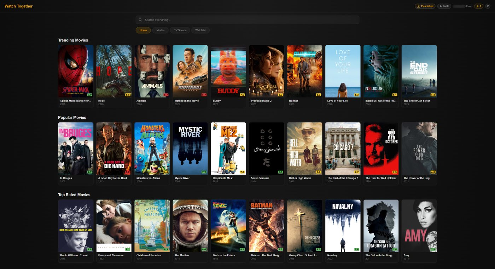

| Page | Shows |
|---|---|
| Home | The same rows as Plex: Continue Watching, recently added, and recommendations |
| Search | Your library and Plex Discover together. Titles the server doesn't have are marked **Not in library**, and can be [requested](Requesting-Titles) when requests are set up. |
| Title | Description, ratings, cast and crew, collection, similar titles, versions, and audio and subtitle tracks |
| Episode | The episode's still, its show, season and number, air date, ratings, synopsis and tracks |
| Season | Every episode, including missing and upcoming ones with their air dates. Available episodes play straight from the list. |
| Cast and crew | The person's titles on the server first, then the rest of their filmography |

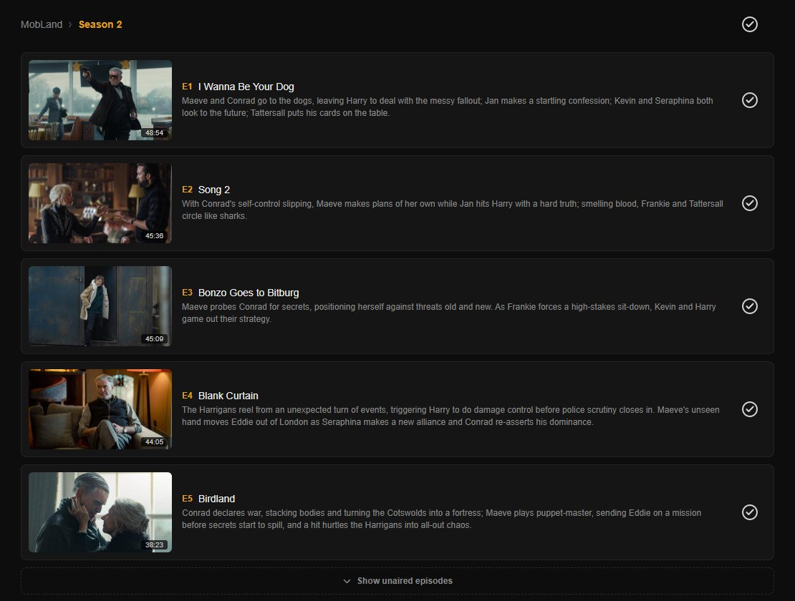

## The player

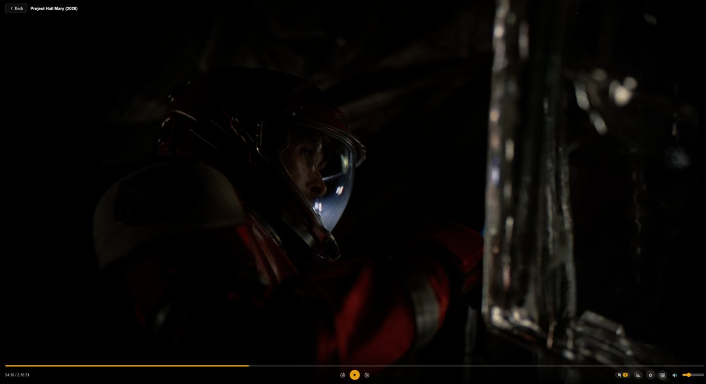

### Controls for everyone

| Control | Does |
|---|---|
| Audio and subtitles | Choose your own tracks. See [Audio and subtitles](#audio-and-subtitles). |
| Quality | **Original**, or 20, 12, 10, 8 or 4 Mbps for a slow connection. Affects only you. |
| Zoom | How the picture fills your screen. See [Zoom](#zoom). |
| Subtitle timing and look | Move subtitles earlier or later in 50 ms steps, and change their size, position, colour, background and font |
| Volume | Your own volume, up to 200% for quiet soundtracks |
| Stats for nerds | Codec, bitrate, frames, audio, subtitles, sync, buffer, connection and peers, and whether the video is copied or re-encoded and why |
| Ask to pause or resume | Asks the host and co-hosts. See [Ask the host to pause](#ask-the-host-to-pause). |

Audio, subtitles, quality and zoom are in the player's settings menu. Subtitle
timing and look have their own button in the player bar.

| 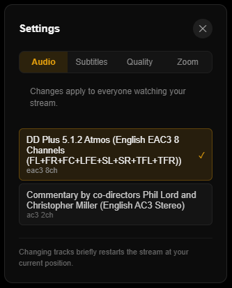 | 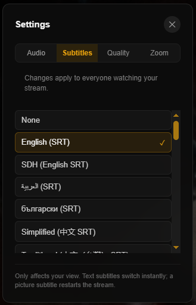 | 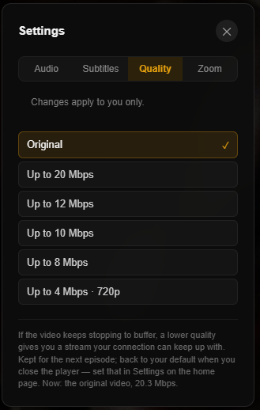 | 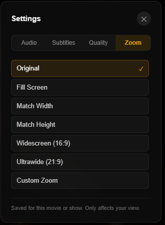 |
| :-- | :-- | :-- | :-- |
| Audio | Subtitles | Quality | Zoom |

### Controls for the host and co-hosts

| Control | Does |
|---|---|
| Play and pause | For the whole room |
| Seek | Everyone follows |
| Skip Intro and Skip Credits | Appear when Plex has detected markers. Everyone follows. |
| Next and previous episode | Everyone follows |
| Play Version | Chooses between versions of a title, when there are several |

A viewer has no play, skip or episode buttons, and the seek bar shows where
the room is without being draggable. Use **Ask to pause** instead.

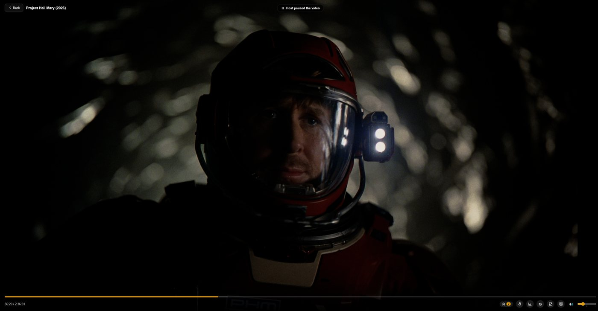

### Keyboard shortcuts

| Key | Action | Who |
|---|---|---|
| `Space` | Play or pause | Host and co-hosts |
| `←` and `→` | Back or forward 10 seconds. Holding the key combines the skips into one seek. | Host and co-hosts |
| `↑` and `↓` | Volume up or down | Everyone |
| `M` | Mute or unmute | Everyone |
| `I` | Stats for nerds | Everyone |

### Phone gestures

| Gesture | Action |
|---|---|
| Tap | Show or hide the controls |
| Double-tap the left third | Back 10 seconds |
| Double-tap the right third | Forward 10 seconds |
| Drag the seek bar | Seek, with preview pictures |

On a phone, play, pause and the episode buttons are in the middle of the
picture.

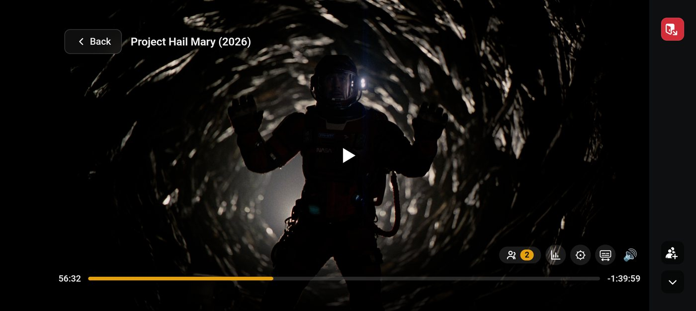

### Next episode and the end of a title

Near the end of an episode, or when its credits start, a **Next Up** card
offers the next episode. Nothing starts on its own: the host or a co-host
chooses it. When a title ends with nothing after it, the player closes and
returns to the library.

## Picture-in-picture

Select **Back** in the player to keep watching in a small window while you
browse.

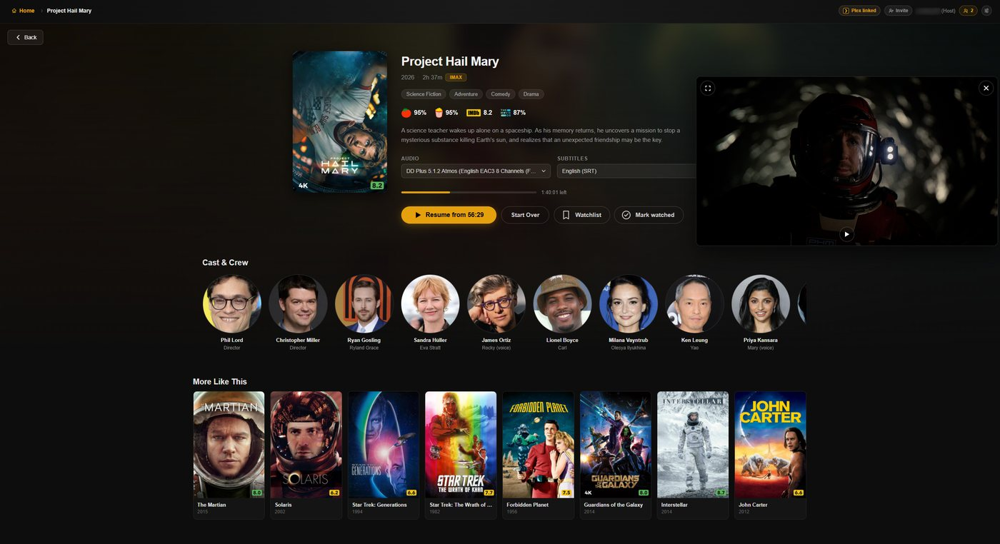

| Action | Desktop | Phone |
|---|---|---|
| Move it | Drag it to an edge | Drag it to an edge |
| Resize it | Drag a corner | Pinch |
| Return to the full player | Double-click, or the expand button | Tap |
| Close it | **X** | **X** |

What **Back** does depends on your role:

| You are | Back |
|---|---|
| A viewer or co-host | Opens picture-in-picture |
| The host, and the title has finished | Ends the stream |
| The host, with others watching | Asks whether to keep watching in picture-in-picture or end the stream for everyone |
| The host, watching alone | Ends the stream if you have watched less than a quarter of the title; otherwise opens picture-in-picture |

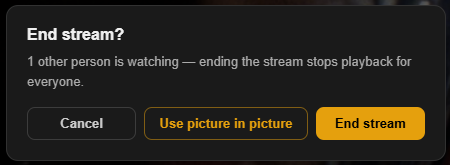

"Watched" counts only time spent playing: pauses and skips ahead don't count.

Starting another title from a title page opens it in the full player. The
next episode, or a title the host starts, stays in the small window.

## Pop-out windows

Discord reloads the Activity when you pop it out into its own window, and again
when you bring it back. The player returns to the room's position, usually
within a second or two, because what it had downloaded is kept on your device.
The room doesn't wait for you, even if you are the host.

In Discord in Firefox, the player loads again from the server, which takes a
few seconds. Firefox may also refuse to start playback with sound in a new
window: the player then starts muted with a note to unmute, or, if Firefox
refuses even that, shows **Click to start**.

## Zoom

In the player's settings, **Zoom** offers **Original**, **Fill Screen**,
**Match Width**, **Match Height**, **Widescreen (16:9)**, **Ultrawide (21:9)**
and **Custom Zoom**. It changes only your own picture, and is saved on your
device for each film or show.

**Custom Zoom** ranges from 50% to 200% in 5% steps. On a computer, use the
zoom control beside the settings button, or hold **Ctrl** and scroll over the
picture. On a phone, pinch to adjust Custom Zoom; in other modes, pinch out
for **Fill Screen** and in for **Original**.

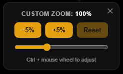

## Audio and subtitles

Who a change reaches depends on your role:

| You are | Changing audio or subtitles |
|---|---|
| A viewer or co-host | Changes only your own. The menu says **Changes apply to you only**. |
| The host | Also moves everyone watching the same tracks as you, each at their own quality. They see **Host is switching audio…** or **…subtitles…**. Anyone who chose their own tracks keeps them. |

Quality is always your own, the host's included.

Viewers on the same audio track share one stream. Choosing another audio
track gives you a stream of your own, so two people can watch the same film in
different languages, in sync. Text subtitles are drawn by each player, so they
never change anyone's stream. A picture subtitle (PGS, VobSub or DVB) that must
be burned into the picture gives you a stream of your own; with the server's
[FFmpeg engine](FFmpeg-Engine), PGS subtitles, and VobSub or DVB inside the
film, are drawn by your player instead.

Your choices carry into the next episode when it has the same tracks, so you
set them once per series. A commentary track stays with its title only.

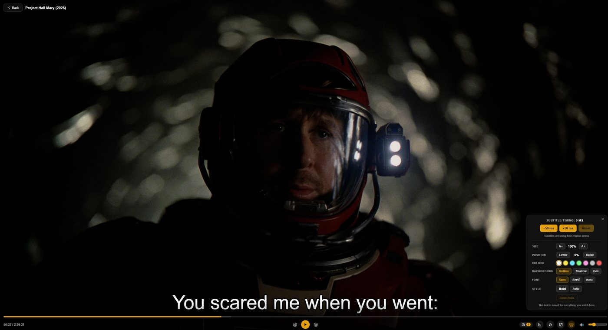

If subtitles are out of sync, adjust their timing in the player bar; the change
applies immediately.

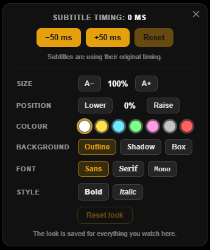

## Quality

Most of the time, everyone sees the same picture. You get a stream of your own,
without changing anyone else's, when:

- **You choose a lower quality** for a slow connection. If playback stalls
  often, the player suggests one (**Buffering a lot?**).
- **Your player can't decode the room's video**, such as HEVC in Discord in
  Firefox. You receive H.264 while everyone else keeps HEVC.

A quality you choose lasts for the title and the next episodes of its show,
through a pop-out or a short break. After 5 minutes away, it returns to your
default from **Settings**. See
[Streaming and Quality](Streaming-and-Quality#quality) for details.

## Ask the host to pause

Select the raised-hand button in the control bar to ask for a pause or a
resume. The host and co-hosts see a card and decide whether to act on it. It
never pauses anything by itself, and you can send one request every few
seconds.

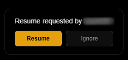

## Suggest a title

Open a title and use the suggest button to propose it to the host. The host
sees a banner: selecting it opens the title, and **Dismiss** clears it. Only
the host decides what plays.

## Settings

**Settings** in the header (the sliders, beside the people list) sets what
every title starts with for you, on this device.

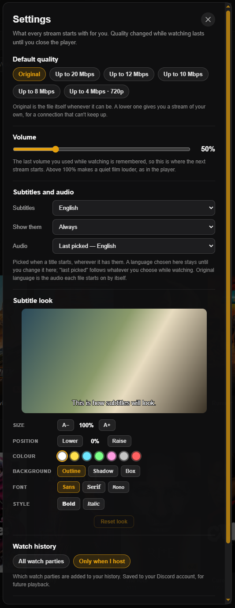

| Section | Sets |
|---|---|
| Default quality | The quality every title starts at. **Original** is the file itself whenever possible. |
| Volume | The volume the next title starts at, up to 200% |
| Subtitles and audio | A subtitle language (or off, or your last choice); whether to show subtitles always or only when the audio is in another language; and an audio language, or each title's original language |
| Subtitle look | Size, position, colour, background, font, bold and italic, with a sample line |
| Watch history | **All watch parties**, or **Only when I host** |
| Saved settings | Reset everything to the defaults |

A language chosen here stays until you change it here. "Last choice" follows
what you pick while watching.

## Watched status, history and Watchlist

**Mark watched** is on every title page. For a show, you can apply it to an
episode, a season or the whole show. If you have
[linked your Plex account](Personal-Plex-Sync), it is saved to your Plex
account; otherwise the Activity keeps it for you.

A title counts as watched when its credits start, or, for a title without a
credits marker, past the Plex server's **Video played threshold** (90% by default). A file
that holds two episodes plays as one: both are marked watched, and **Next**
skips past both.

To keep watch parties you join as a viewer out of your history, choose **Only
when I host** under **Settings → Watch history**, or under **History
settings** on the History tab.

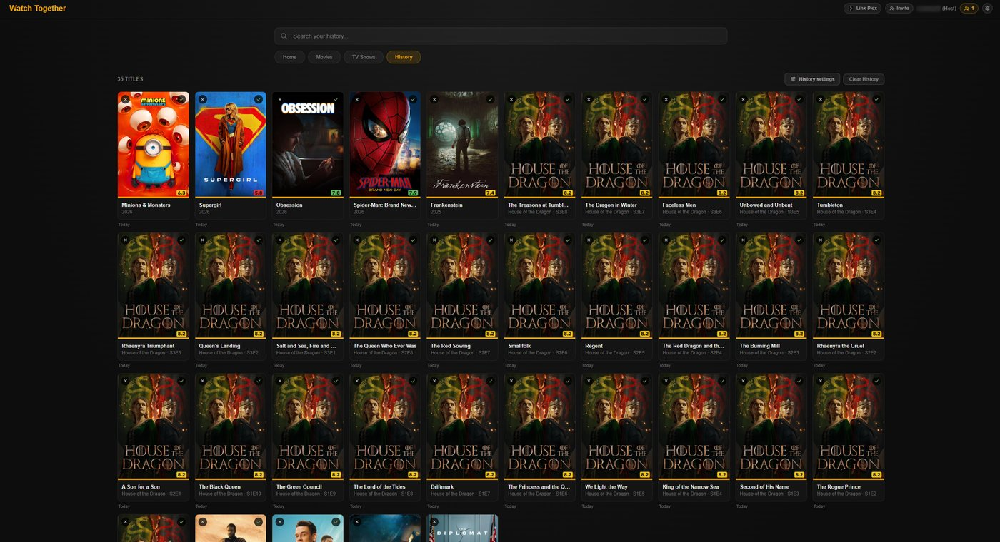

## What Discord shows

While the room plays, your Discord profile shows **Watching** with the title,
its artwork and the room's progress. The invitation in the channel shows the
title and time as well.

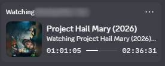

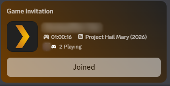

To show a plain watching status instead, open **People** and turn off **Show
media details on Discord**. This is saved on your device and affects only your
own status. Artwork Discord has already fetched may remain in its cache for a
while.

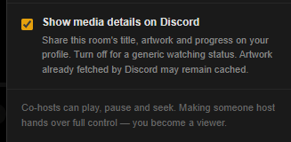

## Messages you may see

| Message | Meaning |
|---|---|
| **Reconnecting to the watch party… (playback continues locally)** | The connection to the room dropped. Your video keeps playing while it reconnects. |
| **Connection lost**, with **Reconnect** | Reconnecting failed. Select **Reconnect**. |
| **Stream interrupted — Reconnecting...** | The video stream stopped. The player is restarting it where you were. |
| **Stream lost**, with **Retry** and **Go Back** | The stream couldn't be restarted. Select **Retry**, or go back and start the title again. |
| **Host is seeking…** | The host skipped, and your player is loading the new position. |
| **Host is switching audio…** | The host changed tracks, and your player is moving to the new stream. |
| **Buffering a lot?** | Playback keeps stalling because your connection can't keep up with the stream. **Try** switches to the suggested quality; **Not now** hides the suggestion for 10 minutes. It goes away by itself once playback recovers. |
| **The picture has stopped on this device, though the video is here.** | Your device's video decoder has stopped. Quit Discord fully (right-click its icon by the clock, then **Quit Discord**) and open it again. Closing the Activity isn't enough. |
| **Session expired** | Your sign-in is older than 24 hours. Close the Activity and open it again. |
| **Unknown instance** | Discord's record of this Activity window is out of date. Close the Activity and open it again. |

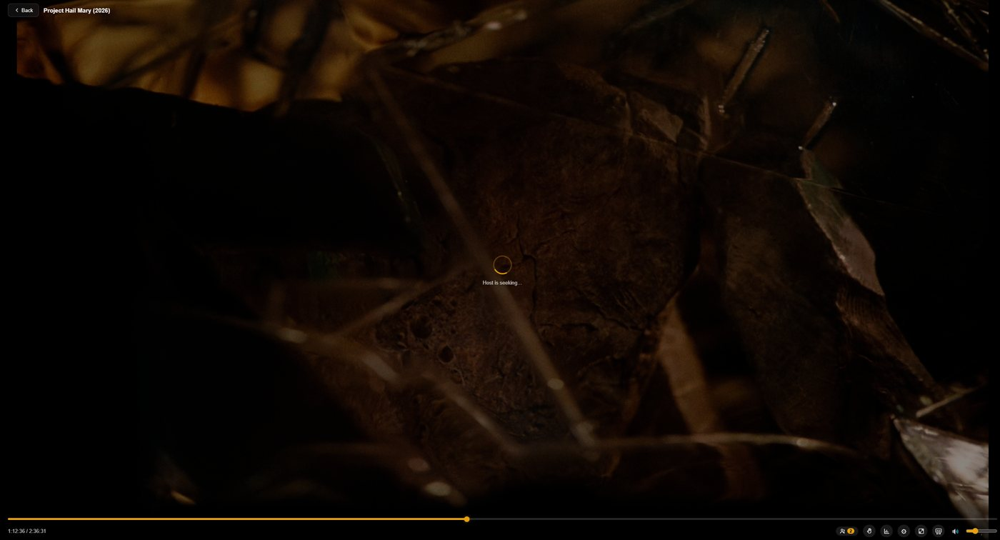

For anything else, see [Troubleshooting](Troubleshooting).

## Next

→ [Roles and Permissions](Roles-and-Permissions)
